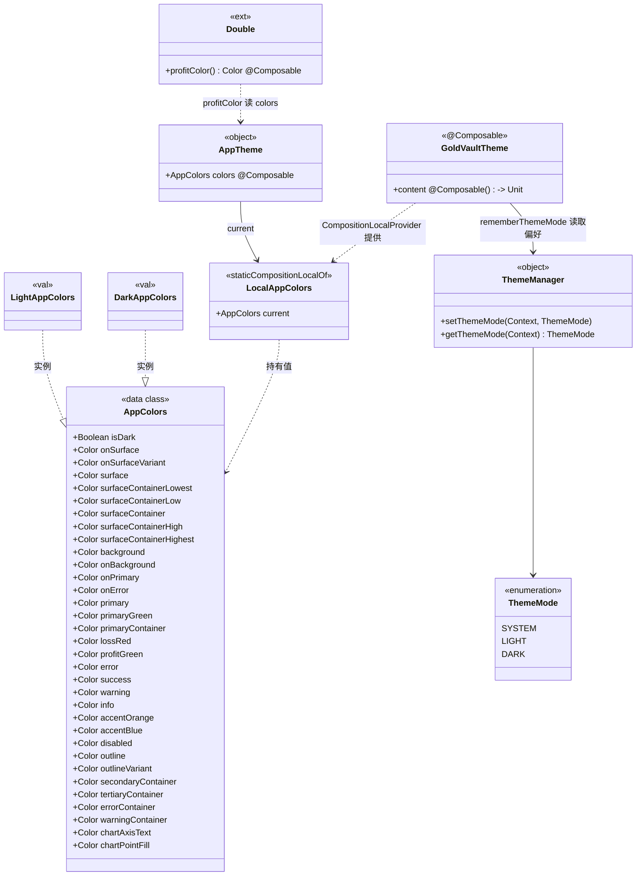
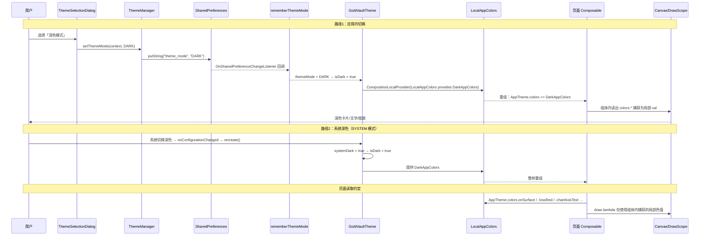
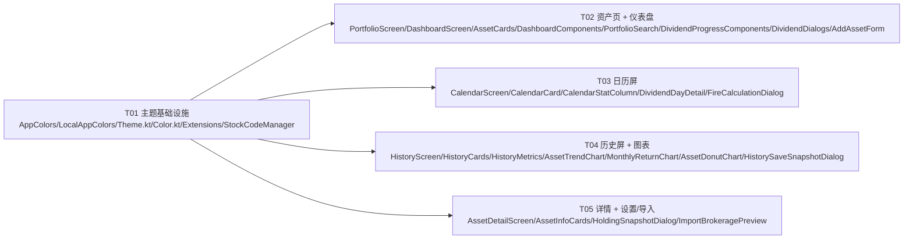

# 金库 App「深色模式根治」系统设计与任务拆解

- 项目：GoldVault（`D:/主人的任务/NewStockDiary`），Kotlin + Compose Material3（compose-bom 2024.02.00 / Compose 1.6.1）+ Room，minSdk 26，包 `com.example.stockdiary`
- 范围：全 App 深浅自适应（用户已确认）
- 角色：架构师 Bob（高见远）｜日期：2026-09
- 性质：只设计不改实现代码；本文档即工程师实施依据

---

# Part A：系统设计

## 1. 实施方式（Implementation Approach）

### 1.1 难点与根因（已核实）

1. **根因**：`ui/theme/Color.kt` 中的语义色是顶层 `val`（编译期常量式的静态值），不随主题切换。约 25 个页面文件直接引用它们（`OnSurface` / `OnSurfaceVariant` / `SurfaceContainerLow` / `SurfaceContainer` / `PrimaryContainer` / `Outline` / `LossRed` / `ProfitGreen` / `Primary` / `OnPrimary` / `Error` / `Warning` / `AccentOrange` / `AccentBlue` / `PrimaryGreen` 等），全项目 `MaterialTheme.colorScheme` 仅 26 处且稀疏。结果深色模式下「深色背景 + 浅色卡片/图表/文字」，整体割裂。
2. **量化**（本次逐一 Read/Grep 核实）：使用语义色的文件约 20 个，引用约 200 处；其中 7 个文件用 `import com.example.stockdiary.ui.theme.*` 通配导入（AssetCards、DashboardComponents、PortfolioScreen、DashboardScreen、AssetDetailScreen、PortfolioSearch、DividendDialogs），其余为显式导入。
3. **图表/Canvas 特例**：`AssetTrendChart` / `MonthlyReturnChart` / `MonthlyCashFlowChart`（DividendProgressComponents 内）/ `AssetDonutChart` 在 `Canvas` 的 `DrawScope` 里直接用顶层色 val 画线、画柱、画弧；还有两处硬编码：`android.graphics.Color.GRAY`（坐标轴文字，AssetTrendChart ×2、MonthlyReturnChart ×1）和 `Color.White`（选中点/选中 chip，AssetTrendChart ×1、HistoryCards ×1）。
4. **非 Composable 上下文用色**：`utils/Extensions.kt` 的 `Double.profitColor()`（返回 LossRed/ProfitGreen，13 个调用点全部在 @Composable 内）、`utils/StockCodeManager.kt` 的 `CodeCategory.color`（枚举属性，AddAssetForm 里用）、`ui/screens/settings/components/ImportBrokeragePreview.kt` 的 5 处硬编码 hex。
5. **既有机制是好的**：`Theme.kt` 的 `GoldVaultTheme` + `rememberThemeMode`（监听 SharedPreferences）+ `ThemeManager` + Light/Dark 两套 M3 `ColorScheme` 本身工作正常，本次不动其切换逻辑，只做「扩展色接入」。

### 1.2 方案选型：扩展色 CompositionLocal（采纳主理人倾向的方案 A）

| 方案 | 做法 | 评价 |
|---|---|---|
| A. 扩展色 CompositionLocal（**选定**） | 新建 `AppColors` 数据类承载全部语义色，`LocalAppColors` + `AppTheme.colors` 读取，`GoldVaultTheme` 按 `isDark` 提供浅/深两套 | ① 浅色值 = Color.kt 现值，浅色模式零视觉变化；② 保留 5 级 surface 层级等细粒度色板，不被迫改设计；③ 改动机械、可分批编译、可回滚；④ 非 Composable 场景（枚举属性）也能通过 `isDark` 字段分支解决 |
| B. 全量迁移 `MaterialTheme.colorScheme` | 把所有语义色用法改成 M3 角色 | 放弃细粒度色板（5 级 surface/primaryContainer 等 M3 角色不全），浅色外观必然变化，回归风险大 |
| C. 动态取色（Android 12+ Monet） | `dynamicDarkColorScheme` | 改变品牌绿色基调，超出「根治深色」范围 |

**结论**：方案 A。`MaterialTheme.colorScheme.*` 已主题感知的 26 处保持不动（避免两套体系互相干扰）；`Theme.kt` 内的 M3 Light/DarkColorScheme 定义不动（仅把 DarkColorScheme 的 `error/onError` 与 AppColors 深色红对齐，见 3.3）。

**架构模式**：现有 MVP/MVVM 分层不变；本次仅在 UI 主题层引入「设计令牌（design token）」层——`AppColors` 即令牌集合，`AppTheme.colors` 即唯一读取入口。

---

## 2. AppColors 字段定义（浅色 + 深色全表）

新建文件 `ui/theme/AppColors.kt`。原则：
- **浅色 = Color.kt 现有非 Dark 值**（保证浅色模式零变化）；
- **深色 = 现有 `*Dark` 值**；
- **无 Dark 变体的共享强调色**：能复用且对比度足够则复用；否则微调并给出 hex 与理由；
- 新增 3 个深色微调 val 到 `Color.kt`（命名 `*Bright`），与图表专用新字段。

| # | 字段 | 浅色值 | 深色值 | 来源 / 深色决策 |
|---|---|---|---|---|
| 1 | `onSurface` | `#1A1A1A` | `#E8E8E8` | TextPrimary / OnSurfaceDark |
| 2 | `onSurfaceVariant` | `#666666` | `#AAAAAA` | TextSecondary / OnSurfaceVariantDark |
| 3 | `surface` | `#FFFFFF` | `#121212` | WhiteSurface / SurfaceDark |
| 4 | `surfaceContainerLowest` | `#F5F5F5` | `#0E0E0E` | WhiteBackground / SurfaceContainerLowestDark |
| 5 | `surfaceContainerLow` | `#F0F0F0` | `#181818` | LightGray / SurfaceContainerLowDark |
| 6 | `surfaceContainer` | `#FFFFFF` | `#1E1E1E` | WhiteSurface / SurfaceContainerDark |
| 7 | `surfaceContainerHigh` | `#F0F0F0` | `#242424` | LightGray / SurfaceContainerHighDark |
| 8 | `surfaceContainerHighest` | `#E0E0E0` | `#2A2A2A` | MidGray / SurfaceContainerHighestDark |
| 9 | `background` | `#F5F5F5` | `#0E0E0E` | WhiteBackground / BackgroundDark |
| 10 | `onBackground` | `#1A1A1A` | `#E8E8E8` | TextPrimary / OnBackgroundDark |
| 11 | `primary` | `#2E7D32` | `#4CAF50` | PrimaryGreen / **微调**：深色无变体，直接复用时小字文本对比 ≈3.2:1 偏暗；提亮为 PrimaryGreenLight（#4CAF50），对比 ≈6:1 |
| 12 | `onPrimary` | `#FFFFFF` | `#0E0E0E` | OnPrimary / OnPrimaryDark（深色 primary 提亮后配深字，FAB/选中 chip 用） |
| 13 | `primaryContainer` | `#E8F5E9` | `#1A2E1A` | PrimaryGreenContainer / PrimaryGreenContainerDark |
| 14 | `lossRed` | `#E53935` | `#FF8A80` | LossRed / **微调**（Material Red 200）：红=涨（A 股惯例），#E53935 深色对比 ≈3.9:1 偏暗 |
| 15 | `profitGreen` | `#43A047` | `#81C784` | ProfitGreen / **微调**（Material Green 200）：绿=跌，同上 |
| 16 | `error` | `#E53935` | `#FF8A80` | Error(=LossRed) / 与 lossRed 深色统一（Color.kt 新增 `LossRedBright`） |
| 17 | `onError` | `#FFFFFF` | `#0E0E0E` | OnError / **微调**：深色 error 提亮后白字对比仅 ≈1.9:1，改深字（用 OnPrimaryDark） |
| 18 | `outline` | `#EEEEEE` | `#333333` | Outline(=BorderLight) / OutlineDark |
| 19 | `outlineVariant` | `#E0E0E0` | `#2A2A2A` | DividerLight / OutlineVariantDark |
| 20 | `warning` | `#FF9800` | `#FFB74D` | AccentOrange / **微调**（Orange 300，Color.kt 新增 `WarningBright`） |
| 21 | `success` | `#43A047` | `#81C784` | Success(=ProfitGreen) / 同 profitGreen 深色（新增 `ProfitGreenBright`） |
| 22 | `info` | `#1976D2` | `#64B5F6` | AccentBlue / TertiaryLight |
| 23 | `accentOrange` | `#FF9800` | `#FF9800` | AccentOrange / **复用**：深色背景对比 ≈9:1 足够（环形图「基金」分类色） |
| 24 | `accentBlue` | `#1976D2` | `#64B5F6` | AccentBlue / **微调**：环形图弧线在深色下 #1976D2 对比 ≈2.9:1 太暗，提亮为 TertiaryLight |
| 25 | `primaryGreen` | `#2E7D32` | `#4CAF50` | PrimaryGreen / **微调**同 primary（环形图「银行存款」分类色） |
| 26 | `disabled` | `#BDBDBD` | `#424242` | Disabled / DisabledDark |
| 27 | `secondaryContainer` | `#1A4CAF50` | `#1A1E1A` | SecondaryContainer / SecondaryContainerDark（色板完整性，当前页面未直接用，随基础设施定义避免工程师自创） |
| 28 | `tertiaryContainer` | `#1A1976D2` | `#1A1E20` | TertiaryContainer / TertiaryContainerDark（同上） |
| 29 | `errorContainer` | `#FFEBEE` | `#1E1212` | ErrorContainer / ErrorContainerDark（ImportBrokeragePreview 异常行底色） |
| 30 | `warningContainer` | `#FFF59D` | `#3A2E00` | **新字段**：浅色保留 ImportBrokeragePreview 现有硬编码行底色；深色新拟深黄棕（承载 #E8E8E8 文字对比 ≈8:1） |
| 31 | `chartAxisText` | `#888888` | `#AAAAAA` | **新字段**：替换 nativeCanvas 的 `android.graphics.Color.GRAY`；浅色保留原灰，深色用 OnSurfaceVariantDark |
| 32 | `chartPointFill` | `#FFFFFF` | `#121212` | **新字段**：替换 AssetTrendChart 选中点 `Color.White`；深色改为底色形成「空心点 + 亮色描边」 |
| 33 | `isDark` | `false` | `true` | 布尔标志，供 `CodeCategory` 等需要二分支的非 Composable 场景使用 |

> 说明：`onPrimaryContainer` / `onSecondaryContainer` / `onErrorContainer` / `inverse*` / `scrim` / `glass*` 等 M3-only 角色继续留在 `MaterialTheme.colorScheme`（已主题感知），不进 AppColors，保持令牌最小集。

---

## 3. 接线方式（CompositionLocal + AppTheme + Theme.kt）

### 3.1 `ui/theme/AppColors.kt`（新建，T01）

```kotlin
package com.example.stockdiary.ui.theme

import androidx.compose.runtime.Composable
import androidx.compose.runtime.staticCompositionLocalOf
import androidx.compose.ui.graphics.Color

/** 全 App 设计令牌。浅色值 = Color.kt 现值；深色值见系统设计文档第 2 节。 */
data class AppColors(
    val isDark: Boolean,
    // 文本
    val onSurface: Color, val onSurfaceVariant: Color, val onBackground: Color,
    val onPrimary: Color, val onError: Color,
    // 表面/容器
    val surface: Color, val surfaceContainerLowest: Color, val surfaceContainerLow: Color,
    val surfaceContainer: Color, val surfaceContainerHigh: Color, val surfaceContainerHighest: Color,
    val background: Color, val primaryContainer: Color, val secondaryContainer: Color,
    val tertiaryContainer: Color, val errorContainer: Color, val warningContainer: Color,
    // 描边
    val outline: Color, val outlineVariant: Color,
    // 品牌/强调
    val primary: Color, val primaryGreen: Color, val lossRed: Color, val profitGreen: Color,
    val error: Color, val success: Color, val warning: Color, val info: Color,
    val accentOrange: Color, val accentBlue: Color, val disabled: Color,
    // 图表专用
    val chartAxisText: Color, val chartPointFill: Color,
)

/** 主题令牌提供源。static：主题切换频率极低、读取点极多，避免逐读追踪开销。 */
val LocalAppColors = staticCompositionLocalOf { LightAppColors }

/** Composable 内唯一读取入口：`AppTheme.colors.xxx`（对齐 MaterialTheme.colorScheme 习惯）。 */
object AppTheme {
    val colors: AppColors
        @Composable get() = LocalAppColors.current
}

internal val LightAppColors = AppColors(
    isDark = false,
    onSurface = TextPrimary,            // #1A1A1A
    onSurfaceVariant = TextSecondary,   // #666666
    surface = WhiteSurface,             // #FFFFFF
    surfaceContainerLowest = WhiteBackground,
    surfaceContainerLow = LightGray,
    surfaceContainer = WhiteSurface,
    surfaceContainerHigh = LightGray,
    surfaceContainerHighest = MidGray,
    background = WhiteBackground,
    onBackground = TextPrimary,
    onPrimary = OnPrimary,
    onError = OnError,
    primaryContainer = PrimaryContainer,
    secondaryContainer = SecondaryContainer,
    tertiaryContainer = TertiaryContainer,
    errorContainer = ErrorContainer,
    warningContainer = Color(0xFFFFF59D),
    outline = Outline,
    outlineVariant = OutlineVariant,
    primary = Primary,
    primaryGreen = PrimaryGreen,
    lossRed = LossRed,
    profitGreen = ProfitGreen,
    error = Error,
    success = Success,
    warning = Warning,
    info = Info,
    accentOrange = AccentOrange,
    accentBlue = AccentBlue,
    disabled = Disabled,
    chartAxisText = Color(0xFF888888),
    chartPointFill = WhiteSurface,
)

internal val DarkAppColors = AppColors(
    isDark = true,
    onSurface = OnSurfaceDark,          // #E8E8E8
    onSurfaceVariant = OnSurfaceVariantDark, // #AAAAAA
    surface = SurfaceDark,              // #121212
    surfaceContainerLowest = SurfaceContainerLowestDark,
    surfaceContainerLow = SurfaceContainerLowDark,
    surfaceContainer = SurfaceContainerDark,
    surfaceContainerHigh = SurfaceContainerHighDark,
    surfaceContainerHighest = SurfaceContainerHighestDark,
    background = BackgroundDark,
    onBackground = OnBackgroundDark,
    onPrimary = OnPrimaryDark,          // #0E0E0E
    onError = OnPrimaryDark,
    primaryContainer = PrimaryContainerDark,
    secondaryContainer = SecondaryContainerDark,
    tertiaryContainer = TertiaryContainerDark,
    errorContainer = ErrorContainerDark,
    warningContainer = Color(0xFF3A2E00),
    outline = OutlineDark,
    outlineVariant = OutlineVariantDark,
    primary = PrimaryGreenLight,        // #4CAF50 微调提亮
    primaryGreen = PrimaryGreenLight,
    lossRed = LossRedBright,            // #FF8A80
    profitGreen = ProfitGreenBright,    // #81C784
    error = LossRedBright,
    success = ProfitGreenBright,
    warning = WarningBright,            // #FFB74D
    info = TertiaryLight,               // #64B5F6
    accentOrange = AccentOrange,        // 复用 #FF9800
    accentBlue = TertiaryLight,         // 微亮
    disabled = DisabledDark,
    chartAxisText = OnSurfaceVariantDark,
    chartPointFill = SurfaceDark,
)
```

### 3.2 `ui/theme/Theme.kt` 修改点（T01）

`GoldVaultTheme` 内在 `MaterialTheme` 外层提供 `LocalAppColors`：

```kotlin
val colorScheme = if (isDark) DarkColorScheme else LightColorScheme
val appColors = if (isDark) DarkAppColors else LightAppColors

CompositionLocalProvider(LocalAppColors provides appColors) {
    MaterialTheme(
        colorScheme = colorScheme,
        typography = Typography,
        content = content
    )
}
```

`rememberThemeMode` / `ThemeManager` / `ThemeMode` / `onConfigurationChanged → recreate()` 的既有切换链路完全不动。

### 3.3 `Color.kt` 修改点（T01，只增不改）

新增 3 个深色微调 val（其余 val 全部保留，仅加 KDoc）：

```kotlin
/** 深色模式微调强调色（无 *Dark 变体的共享强调色提亮，供 DarkAppColors / DarkColorScheme 使用）。 */
val LossRedBright = Color(0xFFFF8A80)
val ProfitGreenBright = Color(0xFF81C784)
val WarningBright = Color(0xFFFFB74D)
```

同时把 `Theme.kt` 的 `DarkColorScheme` 中 `error = Error` → `error = LossRedBright`、`onError = OnErrorDark` → `onError = OnPrimaryDark`，保证 M3 体系与 AppColors 体系的「红/红上文字」一致（ClearDataDialog 等已用 `MaterialTheme.colorScheme.error` 的弹窗同步受益）。LightColorScheme 不动。

---

## 4. 迁移规则（工程师照做）

### 4.1 基本替换

| 旧写法 | 新写法 |
|---|---|
| `color = OnSurface` | `color = AppTheme.colors.onSurface` |
| `containerColor = SurfaceContainerLow` | `containerColor = AppTheme.colors.surfaceContainerLow` |
| `tint = LossRed` | `tint = AppTheme.colors.lossRed` |
| `containerColor = Primary, contentColor = OnPrimary`（FAB） | `containerColor = AppTheme.colors.primary, contentColor = AppTheme.colors.onPrimary` |
| `Text("删除", color = LossRed)` | `Text("删除", color = AppTheme.colors.lossRed)` |

**导入处理**：
- 7 个通配导入文件（AssetCards、DashboardComponents、PortfolioScreen、DashboardScreen、AssetDetailScreen、PortfolioSearch、DividendDialogs）：`ui.theme.*` 已覆盖 `AppTheme`，**无需加导入**；迁移后无用的显式导入一并删除。
- 显式导入文件：删除已迁移符号的 import（如 `import com.example.stockdiary.ui.theme.OnSurface`），新增 `import com.example.stockdiary.ui.theme.AppTheme`。
- `CalendarScreen.kt` 中有 3 处全限定名 `com.example.stockdiary.ui.theme.LossRed / ProfitGreen`，直接换成 `AppTheme.colors.lossRed / AppTheme.colors.profitGreen`。
- `MonthlyReturnChart.kt` 的 `import com.example.stockdiary.ui.theme.OnSurfaceVariant as Outline` 别名**删除**，其「零线」语义 = onSurfaceVariant（保持现有外观：`AppTheme.colors.onSurfaceVariant.copy(alpha = 0.3f)`）；注意该文件的 `Outline` 别名实际指向 OnSurfaceVariant，不要误配成 AppColors.outline。

### 4.2 旧顶层 val 的保留与废弃

- **保留**（Color.kt 一个不删）：① 被 `LightAppColors`/`DarkAppColors`/`Light(Dark)ColorScheme` 引用；② 非 Composable 上下文仍会用（`StockCodeManager.CodeCategory.color`）。
- **页面废弃**：迁移完成后，`app/src/main/java/com/example/stockdiary/ui/` 下除 `ui/theme/` 包外，**任何文件不得再直接引用这些语义 val**（见验收 grep）。
- 在 Color.kt 头部加 KDoc：`// 注意：这些是主题定义源与浅色令牌值。Composable 内一律用 AppTheme.colors.xxx，不要直接引用。`

### 4.3 非 Composable / 辅助函数

1. `utils/Extensions.kt`：
```kotlin// 旧：fun Double.profitColor(): Color = if (this >= 0) LossRed else ProfitGreen
@Composable
fun Double.profitColor(): Color =
    if (this >= 0) AppTheme.colors.lossRed else AppTheme.colors.profitGreen
```
13 个调用点已全部核实位于 @Composable 内（CalendarCard、CalendarScreen、DashboardComponents、AssetTrendChart、MonthlyReturnChart、HistoryCards ×5），**调用点代码零改动**，仅函数签名加 `@Composable`、函数体改读 `AppTheme.colors`。Extensions.kt 增加 `import androidx.compose.runtime.Composable` 与 `import com.example.stockdiary.ui.theme.AppTheme`。
2. `utils/StockCodeManager.kt`：`CodeCategory` 增加 `colorDark` 构造参数（STOCK `#64B5F6`、ETF `#81C784`、LOF `#FFB74D`、EXCHANGE_FUND `#CE93D8`、OTC_FUND `#4DD0E1`、UNKNOWN `#9E9E9E`；浅色 6 个现值不动）；`AddAssetForm.kt` 两处用法改为 `if (AppTheme.colors.isDark) category.colorDark else category.color`。

### 4.4 图表 / Canvas 特殊处理（硬性规则）

> **规则：任何进入 `Canvas`/`DrawScope` 的颜色，必须在 @Composable 作用域内从 `AppTheme.colors` 读出、以局部 val 捕获后再进 draw lambda；禁止在 DrawScope 内引用 Color.kt 顶层 val，禁止用 `remember` 缓存颜色时漏掉主题 key。**

| 文件 | 现状（问题） | 迁移后写法 |
|---|---|---|
| `AssetTrendChart.kt` | `lineColor/gridColor/areaColor` 在 Composable 体内读顶层 val（位置对、来源错）；draw 内 `drawCircle(color = Color.White)`；nativeCanvas 文字用 `android.graphics.Color.GRAY` ×2 | 体内：`val colors = AppTheme.colors; val lineColor = colors.primary; val gridColor = colors.outline.copy(alpha=0.2f); val areaColor = colors.primary.copy(alpha=0.12f); val pointFill = colors.chartPointFill; val axisText = colors.chartAxisText.toArgb()`；draw 内 `drawCircle(color = pointFill, …)`；两处 `Paint().apply { color = axisText }` |
| `MonthlyReturnChart.kt` | draw lambda 内直接 `LossRed/ProfitGreen/OnSurface`；`android.graphics.Color.GRAY` 月份标签；`OnSurfaceVariant as Outline` 别名 | 体内读出 `barUp = colors.lossRed; barDown = colors.profitGreen; selOverlay = colors.onSurface.copy(alpha=0.3f); axisText = colors.chartAxisText.toArgb()` 后进 draw；零线用 `colors.onSurfaceVariant.copy(alpha=0.3f)` |
| `DividendProgressComponents.kt`（MonthlyCashFlowChart） | draw 内 `Primary.copy(alpha=0.35f)` 与 `Primary` | 体内 `val barScheduled = colors.primary.copy(alpha = 0.35f); val barReceived = colors.primary` 后进 draw |
| `AssetDonutChart.kt` | segments 在体内用顶层分类色（位置对）；`remember(onSurfaceVariant/toArgb)` 已是正确范式 | segments 颜色改 `colors.lossRed/colors.accentOrange/colors.accentBlue/colors.primaryGreen`；Paint 的 key 已含主题派生值，保持 `remember(onSurfaceVariant)` 模式（主题切换时 key 变、Paint 重建） |
| `HistoryMetrics.kt` | `OverviewMetric/RiskMetric` 默认参数 `valueColor: Color = OnSurface` | 默认参数改 `AppTheme.colors.onSurface`（@Composable 默认参数内可调用 composable getter）；`DistributionLegend` 的 `color` 为调用方传入，改由 HistoryCards 调用点传 `AppTheme.colors.*` |
| `HistoryCards.kt` | `contentColor = if (isSelected) Color.White else OnSurfaceVariant` | `contentColor = if (isSelected) AppTheme.colors.onPrimary else AppTheme.colors.onSurfaceVariant` |

### 4.5 硬编码 hex 清理（ImportBrokeragePreview.kt）

| 位置 | 旧硬编码 | 新写法 |
|---|---|---|
| L111 提示文字 | `Color(0xFFC62828)` | `AppTheme.colors.error` |
| L120/L206 成功文字 | `Color(0xFF2E7D32)` | `AppTheme.colors.success` |
| L145 异常行底色 | `Color(0xFFFFCDD2)` | `AppTheme.colors.errorContainer` |
| L146 重复行底色 | `Color(0xFFFFF59D)` | `AppTheme.colors.warningContainer` |
| L222 重复提示文字 | `Color(0xFFF57F17)` | `AppTheme.colors.warning` |

### 4.6 不动的部分

`MaterialTheme.colorScheme.*` 现有 26 处（MainActivity、FireCalculationDialog 大部分、ApiSelectionDialog、AdjustPositionDialog、AddAssetDialog/Form 部分、EditAssetDialog、settings 各弹窗、DialogComponents、SafeComponents 等）已主题感知，**保持不动**。`DataVisualization.kt`（WebView 加载 assets HTML）HTML 自有主题，超出本次范围（见第 6 节）。

---

## 5. 文件清单

### 5.1 基础设施（T01）

| 文件（相对 `app/src/main/java/com/example/stockdiary/`） | 改动 |
|---|---|
| `ui/theme/AppColors.kt` | **新建**：AppColors 数据类、LightAppColors、DarkAppColors、LocalAppColors、AppTheme |
| `ui/theme/Theme.kt` | GoldVaultTheme 提供 LocalAppColors；DarkColorScheme 的 error/onError 对齐深色红 |
| `ui/theme/Color.kt` | 新增 LossRedBright/ProfitGreenBright/WarningBright；头部 KDoc 标注「仅主题定义源，页面禁用」 |
| `utils/Extensions.kt` | `profitColor()` 改 @Composable + 读 AppTheme.colors |
| `utils/StockCodeManager.kt` | CodeCategory 增加 colorDark |

### 5.2 迁移文件（T02–T05，符号清单见第 7 节任务表）

- 资产/仪表盘：`ui/screens/PortfolioScreen.kt`、`ui/screens/DashboardScreen.kt`、`ui/components/AssetCards.kt`、`ui/components/DashboardComponents.kt`、`ui/components/PortfolioSearch.kt`、`ui/components/DividendProgressComponents.kt`、`ui/components/DividendDialogs.kt`、`ui/dialogs/AddAssetForm.kt`
- 日历：`ui/screens/CalendarScreen.kt`、`ui/screens/calendar/components/CalendarCard.kt`、`ui/screens/calendar/components/CalendarStatColumn.kt`、`ui/screens/calendar/components/DividendDayDetail.kt`、`ui/components/FireCalculationDialog.kt`
- 历史/图表：`ui/screens/HistoryScreen.kt`、`ui/screens/history/components/HistoryCards.kt`、`ui/screens/history/components/HistoryMetrics.kt`、`ui/screens/history/components/AssetTrendChart.kt`、`ui/screens/history/components/MonthlyReturnChart.kt`、`ui/screens/history/components/AssetDonutChart.kt`、`ui/screens/history/components/HistorySaveSnapshotDialog.kt`
- 详情/设置：`ui/screens/AssetDetailScreen.kt`、`ui/dialogs/AssetInfoCards.kt`、`ui/screens/settings/components/HoldingSnapshotDialog.kt`、`ui/screens/settings/components/ImportBrokeragePreview.kt`

### 5.3 范围外（已核实无语义色直引）

MainActivity、SettingsScreen、ThemeSelectionDialog、ApiSelectionDialog、AddAssetDialog、EditAssetDialog、AdjustPositionDialog、DialogComponents、SafeComponents、LoadingIndicator、ErrorMessage、ImportBrokerageComponents、ImportBrokerageDialog、SettingsItems、ClearDataDialog、DataSourceStatusDialog、DashboardConfigSheet、AboutDialog、LogViewerDialog、ReminderTimePickerDialog、DataVisualization、network/**、data/**、database/**、di/**。

---

## 6. 数据结构与接口



## 7. 程序调用流程

主题切换（应用内）与系统深色跟随（`onConfigurationChanged → recreate()`）两条路径最终都汇合到 `GoldVaultTheme` 重供 `LocalAppColors`，整棵子树重组：



（另存：`docs/sequence-diagram.mermaid`、`docs/class-diagram.mermaid`）

---

## 8. 不明确点与假设（Anything UNCLEAR）

1. **`warningContainer` 深色值 `#3A2E00` 为新拟**（Color.kt 无对应 Dark 变体），工程师可按视觉微调，但浅色必须保持 `#FFF59D`。
2. **`chartPointFill` 深色 `#121212`**：选中点改为「深色底 + 亮色描边」的空心点效果；若产品想要「亮点点」可改 `#E8E8E8`，需主理人确认。
3. **M3 DarkColorScheme 的 error 对齐**（`error=#FF8A80`、`onError=#0E0E0E`）会轻微改变现有深色下错误弹窗按钮观感（白字红底 → 深字亮红底），属改进方向；如主理人要求严格零行为变化，可只改 AppColors、不动 DarkColorScheme，但 AssetDetailScreen 的「删除」按钮需同时迁移 text 色为 `AppTheme.colors.onError` 以自洽。
4. **DataVisualization（WebView）**：`assets/*.html` 图表页自有配色体系，深浅自适应需单独任务（可后续用 `prefers-color-scheme` 媒体查询或按主题注入 CSS 变量），本次不含。
5. **461 单测**：已确认为纯 JVM 单元测试（无 Robolectric/Compose UI 测试），主题迁移不影响测试逻辑；`StockCodeManager` 枚举加构造参数不影响现有测试（`color` 属性保留）。
6. `secondaryContainer` / `tertiaryContainer` / `surfaceContainerHigh(Highest)` / `surfaceContainerLowest` / `disabled` / `info` 当前未被页面直接引用，列入令牌仅为色板完整与防止工程师自创 hex；如主理人希望最小集，可删（不影响迁移任务）。

---

# Part B：任务拆解

## 9. 依赖包

**无新增依赖。** 全部使用现有 Compose runtime（`staticCompositionLocalOf`、`CompositionLocalProvider` 均已在 `androidx.compose.runtime`，随 compose-bom 2024.02.00 引入）。

```
- （无新增）androidx.compose.runtime: CompositionLocal / staticCompositionLocalOf —— 随现有 compose-bom 提供
- （无新增）androidx.compose.ui:ui-graphics —— Color/toArgb 已依赖
```

## 10. 任务列表（有序，≤5，按屏分批可独立编译）

### T01 主题基础设施（P0，无依赖）

- **Source Files**：
  - `app/src/main/java/com/example/stockdiary/ui/theme/AppColors.kt`（新建）
  - `app/src/main/java/com/example/stockdiary/ui/theme/Theme.kt`（provide LocalAppColors；DarkColorScheme error 对齐）
  - `app/src/main/java/com/example/stockdiary/ui/theme/Color.kt`（+3 个 Bright val；KDoc）
  - `app/src/main/java/com/example/stockdiary/utils/Extensions.kt`（profitColor @Composable 化）
  - `app/src/main/java/com/example/stockdiary/utils/StockCodeManager.kt`（CodeCategory +colorDark）
- **Dependencies**：无
- **Priority**：P0
- **完成判据**：`./gradlew :app:compileDebugKotlin` 通过；AppTheme.colors 两套值可被预览/断点确认；此时页面尚未迁移，视觉零变化。

### T02 资产页 + 仪表盘（P0，依赖 T01）

- **Source Files 与迁移符号**：
  - `ui/screens/PortfolioScreen.kt`：`Primary`、`OnPrimary`（FAB L382-383）、`Error`（删除按钮 L627）
  - `ui/screens/DashboardScreen.kt`：`Primary`、`OnPrimary`（FAB L166-167）
  - `ui/components/AssetCards.kt`（~25 处）：`PrimaryContainer`×3、`SurfaceContainer`×2、`SurfaceContainerLow`×2、`OnSurface`×11、`OnSurfaceVariant`×9、`Outline`、`ProfitGreen`、`Primary`×3
  - `ui/components/DashboardComponents.kt`（~15 处）：`SurfaceContainer`、`Outline`×2、`OnSurface`、`OnSurfaceVariant`×5、`Primary`×3、`Warning`×2、`profitColor()`
  - `ui/components/PortfolioSearch.kt`（~11 处）：`OnSurface`×3、`OnSurfaceVariant`×7、`Outline`、`Primary`×2、`SurfaceContainerLow`
  - `ui/components/DividendProgressComponents.kt`（~20 处）：`SurfaceContainer`×3、`OnSurface`×3、`OnSurfaceVariant`×11、`Outline`×2、`Primary`×6（**含 MonthlyCashFlowChart draw lambda 内 2 处，按 4.4 规则**）
  - `ui/components/DividendDialogs.kt`（~20 处）：`OnSurfaceVariant`×8、`OnSurface`×4、`LossRed`×4、`Primary`×2、`PrimaryContainer`、`SurfaceContainerLow`
  - `ui/dialogs/AddAssetForm.kt`：`CodeCategory.color`×2 → isDark 分支
- **Dependencies**：T01
- **Priority**：P0
- **完成判据**：编译通过；深色下仪表盘/资产页无浅色卡片、浅色文字。

### T03 日历屏（P0，依赖 T01）

- **Source Files 与迁移符号**：
  - `ui/screens/CalendarScreen.kt`（~17 处）：`OnSurface`×4、`OnSurfaceVariant`×6、`Primary`×3、`PrimaryContainer`×2、`SurfaceContainer`×2、全限定名 `LossRed`/`ProfitGreen`×3
  - `ui/screens/calendar/components/CalendarCard.kt`（~21 处）：`LossRed`×3、`OnSurface`×5、`OnSurfaceVariant`×9、`Outline`×2、`Primary`×7、`ProfitGreen`×2、`SurfaceContainer`、`SurfaceContainerLow`、`profitColor()`
  - `ui/screens/calendar/components/CalendarStatColumn.kt`：`OnSurfaceVariant`（组件内）；调用点（CalendarScreen）传色迁移
  - `ui/screens/calendar/components/DividendDayDetail.kt`（~9 处）：`LossRed`、`OnSurface`×2、`OnSurfaceVariant`×5、`Outline`×2
  - `ui/components/FireCalculationDialog.kt`：`LossRed`×1（L98）
- **Dependencies**：T01
- **Priority**：P0
- **完成判据**：编译通过；深色下日历格子、图例、月份汇总、FIRE 弹窗无浅色残留。

### T04 历史屏 + 全部图表（P0，依赖 T01）

- **Source Files 与迁移符号**：
  - `ui/screens/HistoryScreen.kt`：`OnSurfaceVariant`×3
  - `ui/screens/history/components/HistoryCards.kt`（~21 处）：`AccentBlue`、`AccentOrange`、`LossRed`×2、`OnSurface`×5、`OnSurfaceVariant`×8、`Primary`、`PrimaryGreen`、`ProfitGreen`、`SurfaceContainerLow`、`Color.White`×1→`onPrimary`、`profitColor()`×5
  - `ui/screens/history/components/HistoryMetrics.kt`：默认参数 `OnSurface`×2 → `AppTheme.colors.onSurface`；`OnSurfaceVariant`×3
  - `ui/screens/history/components/AssetTrendChart.kt`（~12 处）：`OnSurface`×3、`OnSurfaceVariant`×3、`Outline`、`Primary`×3、`SurfaceContainerLow`、`Color.White`→`chartPointFill`、`Color.GRAY`×2→`chartAxisText.toArgb()`、`profitColor()`
  - `ui/screens/history/components/MonthlyReturnChart.kt`（~10 处）：`LossRed`、`ProfitGreen`、`OnSurface`、`OnSurfaceVariant as Outline`（删别名）、`SurfaceContainerLow`、`Color.GRAY`→`chartAxisText.toArgb()`、`profitColor()`、**draw lambda 内 3 处色按 4.4 规则上移**
  - `ui/screens/history/components/AssetDonutChart.kt`：4 个分类色 → `colors.lossRed/accentOrange/accentBlue/primaryGreen`（Paint remember key 模式保持）
  - `ui/screens/history/components/HistorySaveSnapshotDialog.kt`：`ProfitGreen`×1
- **Dependencies**：T01
- **Priority**：P0
- **完成判据**：编译通过；深色下折线/柱状/环形图、选中浮卡全部随主题；坐标轴文字清晰可见。
- **注意**：本批是 Canvas 规则集中区，改完必须在真机/预览深色模式下逐图检查。

### T05 资产详情 + 设置/导入弹窗（P1，依赖 T01）

- **Source Files 与迁移符号**：
  - `ui/screens/AssetDetailScreen.kt`（~11 处）：`OnSurfaceVariant`×5、`Error`×2、`SurfaceContainer`×2、`Primary`×1；L328 `MaterialTheme.colorScheme.onError` 与 `Error` 容器混用 → 统一 `AppTheme.colors.onError`
  - `ui/dialogs/AssetInfoCards.kt`：`LossRed`、`ProfitGreen`
  - `ui/screens/settings/components/HoldingSnapshotDialog.kt`（~4 处）：`LossRed`×3、`ProfitGreen`×1
  - `ui/screens/settings/components/ImportBrokeragePreview.kt`：5 处硬编码 hex → `error/success/errorContainer/warningContainer/warning`（映射表见 4.5）
- **Dependencies**：T01
- **Priority**：P1
- **完成判据**：编译通过；深色下详情页、持仓快照弹窗、券商导入预览无浅色/刺眼硬编码色。

> 任务顺序说明：T02–T05 均只依赖 T01，彼此独立，可并行；但建议按 T02→T03→T04→T05 顺序由同一工程师执行，便于按「屏幕」走查。每批完成立即 `compileDebugKotlin`，保证分批可独立编译。

## 11. 验收标准与工程师自验步骤

**验收标准**：
1. `./gradlew :app:assembleDebug` 通过；
2. `./gradlew :app:testDebugUnitTest` 全部通过（基线 461 个，零回归）；
3. 深/浅两套主题下均无写死浅色残留（代码级 + 视觉级双重确认）；
4. 浅色模式视觉与迁移前一致（AppColors 浅色值 = Color.kt 现值）。

**自验步骤**：
1. 每批迁移后运行 `./gradlew :app:compileDebugKotlin`，全绿再进入下一批。
2. 全部完成后跑 `./gradlew :app:assembleDebug` 与 `./gradlew :app:testDebugUnitTest`。
3. 代码级残留检查（预期输出为空）：
   ```bash
   grep -rn "ui\.theme\.\(OnSurface\|OnSurfaceVariant\|OnBackground\|SurfaceContainer\w*\|PrimaryContainer\|Outline\w*\|LossRed\|ProfitGreen\|Primary\b\|OnPrimary\|Error\b\|Warning\b\|Success\b\|Info\b\|Accent\w*\|PrimaryGreen\|TextPrimary\|TextSecondary\|WhiteSurface\|LightGray\|MidGray\|DarkGray\)" \
     app/src/main/java/com/example/stockdiary --include=*.kt | grep -v "/ui/theme/"
   ```
   再检查 Canvas 内是否还有顶层色/GRAY/White 残留：
   ```bash
   grep -rn "Color\.White\|Color\.Gray\|android\.graphics\.Color\.GRAY\|Color(0x" app/src/main/java/com/example/stockdiary --include=*.kt | grep -v "/ui/theme/"
   ```
   预期：仅剩 `Color.Transparent`、ImportBrokeragePreview 之外无 hex（该文件迁完后也为空）。
4. 视觉走查（设置 → 主题 → 深色，再切回浅色）：
   - 深色：仪表盘、资产、日历、历史、设置 5 屏 + 以下弹窗：添加/编辑资产、分红详情、FIRE 计算器、持仓快照、券商导入预览、资产详情——重点看卡片底色、次级文字、图表（折线/柱/环/日历格子）、盈亏红绿、坐标轴文字；
   - 浅色：同路径回归，确认与改前一致（尤其 StatusHint 橙、导入预览黄/红行底色、周期选中 chip）；
   - 系统深色 + App 内「跟随系统」组合切换一次，确认 `recreate()` 后无残留。
5. 切换主题时停在各屏观察 1–2 秒，确认无「半新半旧」闪烁异常（staticCompositionLocalOf 整树重供，预期整树齐变）。

## 12. 共享知识（跨切面约定）

- **唯一读取入口**：Composable 内主题色一律 `AppTheme.colors.xxx`（`object AppTheme` 的 @Composable get）；禁止直接引用 Color.kt 顶层语义 val。
- **Canvas/DrawScope 硬规则**：颜色在 @Composable 组体内读出并捕获为局部 val 后再进 draw lambda；DrawScope 内禁止引用顶层色 val；`remember` 缓存 Paint/Path/PathEffect 时，主题派生值必须进 key（参考 AssetDonutChart 现有 `remember(onSurfaceVariant)` 范式）。
- **nativeCanvas 文字**：`android.graphics.Paint.color` 用 `AppTheme.colors.chartAxisText.toArgb()`，不写死 `android.graphics.Color.GRAY`。
- **盈亏色语义（勿搞反）**：红 = 涨/正（`lossRed`），绿 = 跌/负（`profitGreen`）——A 股惯例，`profitColor()` 已封装（>=0 红、<0 绿）。
- **深色微调色集中管理**：`LossRedBright`/`ProfitGreenBright`/`WarningBright` 三个新 val 在 Color.kt，DarkAppColors 与 DarkColorScheme 共用，禁止在页面里自创 hex。
- **浅色零变化是硬约束**：LightAppColors 的每个值必须等于 Color.kt 现值；浅色模式不允许任何视觉变化。
- **导入规范**：通配导入文件不动 import；显式导入文件删旧Symbol import、加 `AppTheme` import；不使用 import alias 引用主题色（MonthlyReturnChart 的 `as Outline` 别名废除）。
- **MaterialTheme.colorScheme.\*** 已主题感知，保持不动；两套体系（M3 scheme / AppColors）并存是刻意设计，不要互相「补齐」。
- **编译门槛**：每批（T02–T05）完成即 `compileDebugKotlin`，分批可独立编译、独立验证。
- 单测基线 461 个为纯 JVM 测试；任何 `data/`、`utils/`（除 Extensions.profitColor 与 StockCodeManager 外）逻辑不得改动。

## 13. 任务依赖图



---

*附：`docs/sequence-diagram.mermaid`、`docs/class-diagram.mermaid` 为第 6/7 节两张图的独立副本，便于工程师直接粘贴到支持 Mermaid 的工具中查看。*
