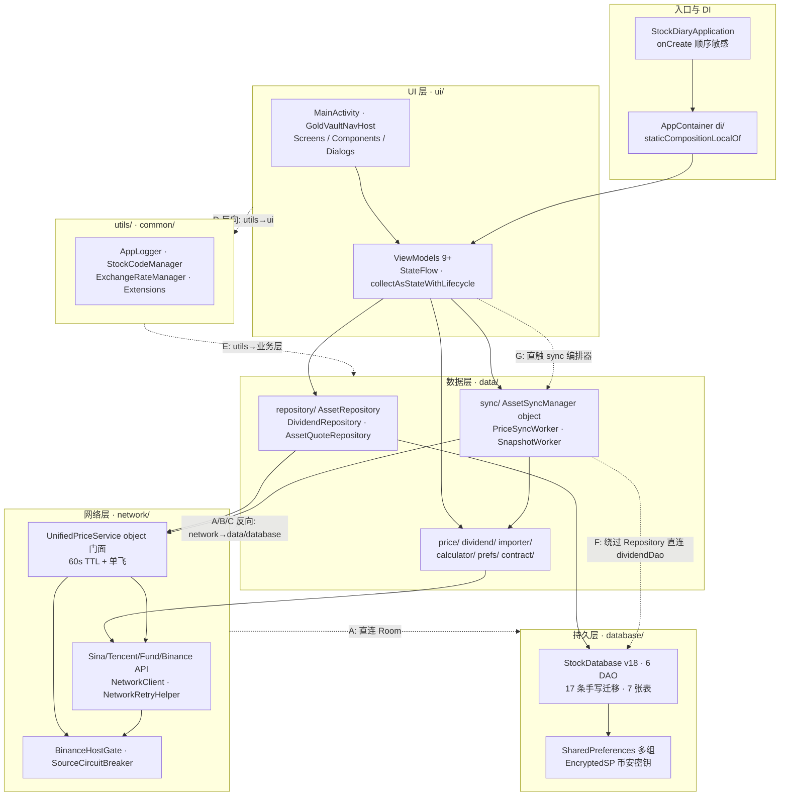
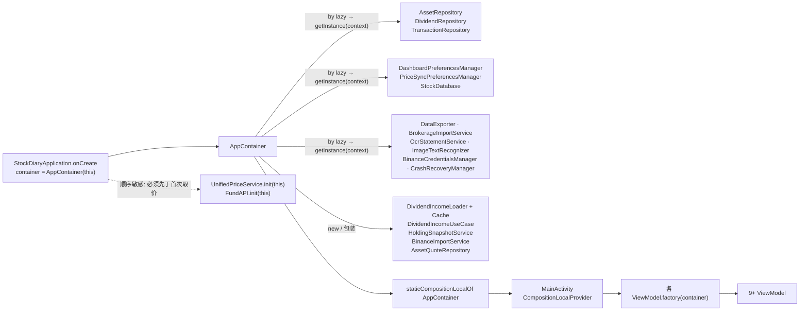
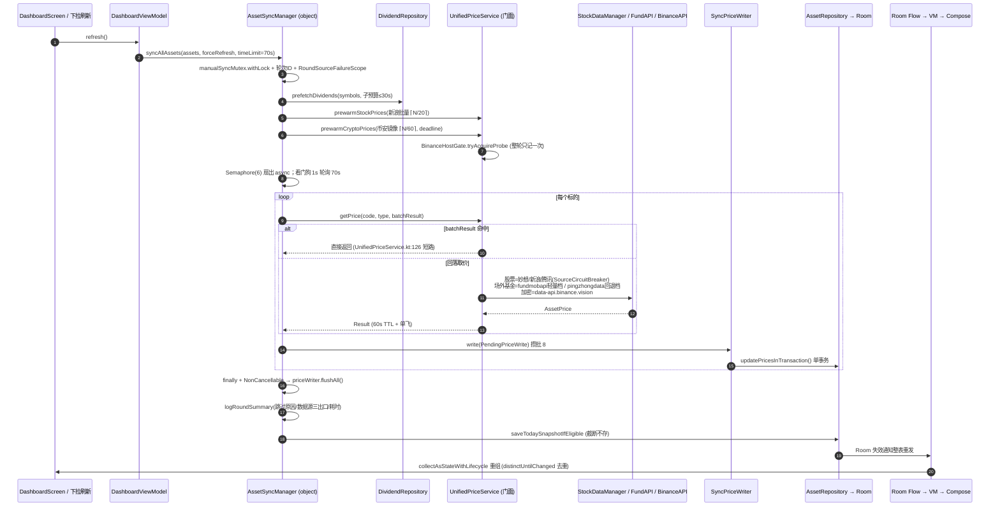
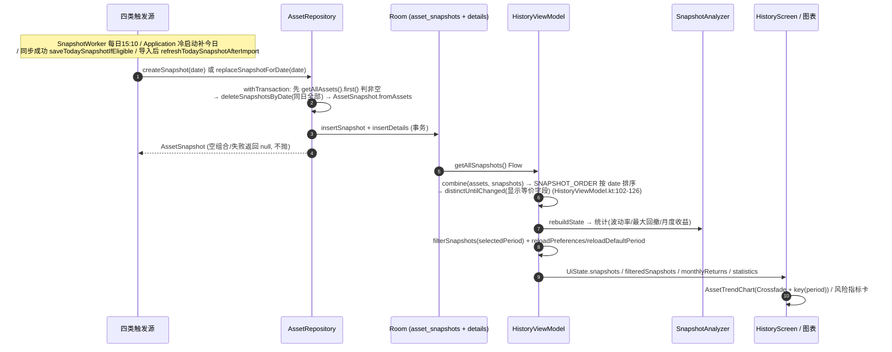
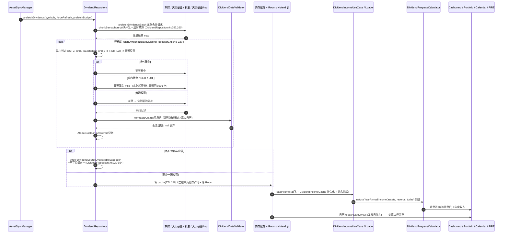
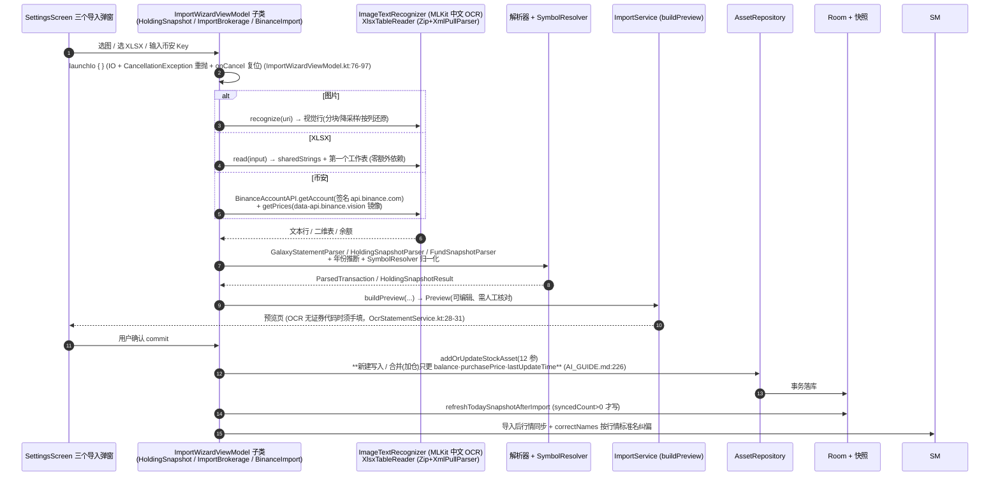

# 金库 App（GoldVault / NewStockDiary）架构只读评审报告

| 项 | 内容 |
|---|---|
| 评审日期 | 2026-11-06 |
| 评审人 | 高见远（架构师，软件架构只读评审） |
| 评审对象 | `D:\主人的任务\NewStockDiary`（Gradle 单模块，`:app`，namespace `com.example.stockdiary`） |
| 代码基线 | `git log -1` = `b69337f test(回归): 补并发写原子性、熔断 CAS 竞态与导入侧多页汇总用例`；`git ls-files` = 366 |
| 评审性质 | **只读评审**。未修改/删除/重命名任何源码、配置、文档；未执行 gradle 构建与全量测试；唯一写入为本报告 |
| 方法 | 静态分析：通读 4 份文档 + 抽样精读 40 余个关键类 + 全仓 Grep（反模式、依赖方向、状态、并发、常量）+ `find/wc/grep/git` 只读统计 |
| 语言 | 简体中文 |

---

> **时效性注记（本文后续演进）**：本评审建议 **#1**（新增 `tools/check_invariants.py` 机器守卫）已落地，且于后续 **G6**（`2d3e98f`）从最初的 **6 条断言（A1–A6）扩至 9 条（A1–A9）**——新增 **A7 锁 Room 版本 v18**（禁止 `MIGRATION_18_19`，本机无 adb 无法真机验证迁移）、**A8 同步入口收口**（`syncAllAssets` 调用点必须全在 `PriceSyncCoordinator.kt`）、**A9 血缘零持久化 + 源标识唯一**（`PriceLineageRecorder` 不得接持久化原语；价/源交汇文件的 `source` 字段必须走 `SourceIds`，防"腾讯源价谎称新浪"）。门禁 `tools/check_gate.sh` 现为 **8 步**（原 6 项编译/迁移/测试 + 2 项不变量校验，且两条校验恒在 `--skip-unit-test` 之外）。因此本文中"6 条断言""6 步"均为评审当时（基线 `b69337f`）的措辞，现行规范以 `tools/check_invariants.py` 与 `tools/check_gate.sh` 为准。

## 0. 执行摘要

### 0.1 总体判断

这是一个**单人维护、已上线真机、演进式叠加**的个人资产记账 App。它的工程质量明显高于同规模个人项目：KDoc 注释大量记录"为什么这么做"、失败语义被细分到"停牌 / 不可交易 / 熔断 / 协程取消都不算同步失败"、取消不吞（`CancellationException` 一律重抛）、防御式输入校验、结构化诊断日志、1335 个 `@Test`、专门防"假绿灯"的门禁脚本。

但架构层面存在三类**实质性但不紧急**的债务，以及一类**紧急**的防线缺口：

1. **不是严格分层**：`network ↔ data/database` 双向依赖、`utils` 是"什么都依赖"的杂糅层（甚至 `utils → ui`）、`data/sync` 绕过 Repository 直连 DAO。UI 与持久层/网络层的边界反而收口得不错（`AppContainer.kt:59-60` 的"审计 H1"确实生效）。
2. **状态与并发是"多份副本 + 分散预算"**：54 个 `object` 进程级单例、4 个 ViewModel 各持一份偏好内存副本靠 `ON_RESUME` 收敛、6 层各自 `Semaphore` 叠加、熔断阈值 `8` 与并发度 `6` 分处三个文件靠注释和单测维系。
3. **没有真正的导航与 DI 框架**：声明了 `navigation-compose:2.7.7` 却用 `when(selectedScreen)` 手写切换；`AppContainer` 自称"替代 Service Locator"，底层 20 个属性几乎全是 `Xxx.getInstance(context)`，本质是 Service Locator 的薄门面。
4. **【最紧急】所有关键不变量都靠"人记 + 人工门禁"，而门禁无 CI、唯一的仪器测试从不执行。** 历史事故（阈值 5 一波并发误熔跳过 130 个标的、偏好整块覆盖、`SyncPriceWriter` 尾部静默丢价、迁移校验假绿）全部来自"看似无害的小改动"突破了某条隐性约束。

**一句话结论**：不需要"上 Hilt / 拆多模块 / 重做导航"这类大重构（成本高、回归风险高、对单人维护收益低，且 `AI_GUIDE.md:209` 已明令别引入 Hilt）。真正该补的是**把散落在 KDoc 里的隐性不变量变成机器可校验的守卫**，并让迁移验证真正跑起来。

### 0.2 最关键的 7 条结论

| # | 结论 | 核心证据 |
|---|---|---|
| 1 | **隐性不变量无机器守卫**；`FAIL_THRESHOLD=8` 必须 `> MAX_CONCURRENT_SYNC=6` 是跨三文件的口头铁律，注释漂移已发生 | `network/BinanceHostGate.kt:85-95`、`data/sync/AssetSyncManager.kt:78`、`data/price/SourceCircuitBreaker.kt:177-183`；`network/NetworkClient.kt:69-70` 注释仍写"价格同步 8"，与当前 6 不符 |
| 2 | **DB v18 / 17 条手写迁移 / 无 `fallbackToDestructiveMigration`，但唯一端到端迁移测试零执行路径** | `database/StockDatabase.kt:22-32, 424-442`；`tools/check_gate.sh:125` 只 `compileDebugAndroidTestKotlin`；`androidTest` 仅 `MigrationTest.kt`（1 个 `@Test`）；`tools/validate_migration.py:24-26` 自述"门禁里只编译不执行" |
| 3 | **门禁设计严谨但纯人工、无 CI** | `tools/check_gate.sh:123-143`（6 步全 `--rerun` + `verify_test_count` 防假绿）；仓库无 `.github/`、无任何 `*.yml/*.yaml`（只读统计核实）；`:23-24` 还有 `--skip-unit-test` 快速通道 |
| 4 | **分层倒置是真实存在的**，非文档过时 | `network/FundAPI.kt:5-7` → `database.StockDatabase / FundNavCacheDao`；`utils/Extensions.kt:9` → `ui.theme.AppTheme`；`data/sync/PriceSyncWorker.kt:227-230` 直连 `dividendDao()` |
| 5 | **状态管理整体健康但无单一事实源**：全量 `StateFlow` + `collectAsStateWithLifecycle`、无 `LiveData`/`GlobalScope`、一次性事件刻意不用 `SharedFlow`（有完整论证）；但偏好是"磁盘 SP + 4 份 VM 内存副本 + ON_RESUME 最终一致"，且 `savePreferences` 仍 public | `ui/viewmodels/DashboardViewModel.kt:75-162, 105-126`；`data/prefs/DashboardPreferencesManager.kt:189, 237-243`；`ui/screens/DashboardScreen.kt:136` |
| 6 | **并发预算分散叠加、取消语义不完整**：看门狗 `jobs.cancel()` 打不断 OkHttp 同步 `execute()`，只靠 `callTimeout=20s` 兜底；失败大量降级为"跳过"只进日志，UI 无信号 | `data/sync/AssetSyncManager.kt:163-166, 690-710, 1096-1128`；`network/NetworkClient.kt:51`；`common/APIConfig.kt:80` |
| 7 | **README 被标"✅ 可信"却含 8+ 处硬事实错误**（versionCode 6→11、Retrofit→已删、kapt→KSP、SDK 34→35、币安共用闸门→已解耦、DataManager→不存在、测试数三份文档三个值） | `README.md:7,14,15,19,33,79,81,87` vs `app/build.gradle.kts:6,11,16,17,74,113,116-119`；Bash 统计 `@Test` = 1335 |

### 0.3 做得好的地方（先说优点，避免只挑刺）

- **取消纪律统一**：`CancellationException` 一律第一个 `catch` 并重抛（`NetworkRetryHelper.kt:43,150`、`SyncSnapshotPolicy.kt:69`、`PriceSyncWorker.kt:145`、`ImportWizardViewModel.kt:86-91`、`AssetSyncManager.kt:1131,1138`）；`NonCancellable` 只用于"必须完成的写库"（`AssetSyncManager.kt:737,976,1010,1044,1078`）。
- **失败语义细化**：停牌 / 不可交易 / 币安熔断 / 协程取消都不计入 `failedCount`（`AssetSyncManager.kt:1096-1128`），避免"请检查网络"式误报骚扰。
- **可观测性强**：轮次 ID、`logRoundSummary` 单行结构化汇总（成功/失败/跳过原因/三出口数据源统计/耗时）、`lastRoundSummaryForDiagnostics()` 供诊断报告头部、内存水位 + `onTrimMemory` 取证、日志脱敏（`NetworkClient.kt:100-122`）、非 2xx 提升 WARN（`AssetSyncManager.kt:759-832`）。
- **防御式数据入口**：`DividendDateValidator` 挡日历不存在的脏日期（`data/dividend/DividendDateValidator.kt:6-43`）、分红"未应答不写负缓存"（`DividendRepository.kt:892-924`）、`XlsxTableReader` 零依赖且 32MB 上限（`data/importer/XlsxTableReader.kt:14-39`）。
- **空安全**：全仓 `!!` 仅 3 处；无 `GlobalScope`、无 `Thread.sleep`、无真实 `TODO/FIXME`（Grep 命中的 `XXX` 均为 `XXXUSDT` 占位符）。
- **刻意口径差异有文档 + 有测试钉住**：收息按除息日 / 日历按发放日（`PROJECT_MEMORY.md:27-28`、`DividendData.kt:47-49`）、两个 451 路径（`APIConfig.kt:30,43`）、隐藏低价值币只影响列表（`DashboardPreferencesManager.kt:46-50`）——**均不应被当成"该统一却没统一"的缺陷**。

---

## 1. 分层与依赖方向

### 1.1 实际包结构（静态统计）

`app/src/main/java/com/example/stockdiary/` 下 **189 个 `.kt`**，分包为：

| 包 | 职责 | 代表类 |
|---|---|---|
| `database/` | Room 实体 + 6 个 DAO + 17 条迁移 | `StockDatabase(v18)`、`Asset`、`AssetSnapshot`、`DividendDao` |
| `data/repository/` | 仓储 | `AssetRepository`、`DividendRepository`、`AssetQuoteRepository`、`TransactionRepository` |
| `data/sync/` | 同步编排 + Worker + 预算 + 快照策略 | `AssetSyncManager`(object)、`PriceSyncWorker`、`SnapshotWorker`、`SyncBudget`、`SyncSnapshotPolicy` |
| `data/price/` / `dividend/` / `importer/` / `calculator/` / `prefs/` / `contract/` / `export/` | 领域服务与纯函数 | `StockDataManager`、`SourceCircuitBreaker`、`DividendProgressCalculator`、`DashboardPreferencesManager`、`SyncStrategy` |
| `network/`（含 `base/` `cache/` `model/`） | 行情/分红/币安客户端 + 熔断 | `UnifiedPriceService`(object 门面)、`NetworkClient`、`BinanceHostGate`、`NetworkRetryHelper` |
| `ui/`（`screens/` `viewmodels/` `components/` `dialogs/` `theme/` `navigation/`） | Compose UI | `GoldVaultNavHost`、9+ ViewModel |
| `utils/` / `common/` / `di/` | 工具、常量、手写容器 | `AppLogger`、`APIEndpoints`、`AppContainer` |

### 1.2 分层判定

**MVVM + Repository，不是 Clean Architecture**：链路是 `Screen → ViewModel → Repository/Service → DAO/API`（`AI_GUIDE.md:208` 亦如此声明）。没有独立 domain 层、没有 use case 层（唯一 `DividendIncomeUseCase` 是 `AppContainer.kt:38-42` 里一个薄函数接口）；`data/contract/` 是被 network 与 sync 共用的"共享内核叶子包"（`data/contract/SyncStrategy.kt:14-20`）。Room 实体（`database.Asset`）被直接当作领域模型一路传到 UI，未做 DTO 隔离——对本项目规模是合理简化。

**UI 侧收口良好**：Grep 确认 `ui/` 下**没有** `import ...AssetDao / StockDatabase / network.*` 实现类；行情统一经 `AssetQuoteRepository`（`AppContainer.kt:59-60` 注释"审计 H1：UI 通过它取行情，不直接调 network 层"）。UI 大量 `import database.Asset/AssetType/AssetSnapshot` 属于实体模型复用，不算跨层。

**但真实存在的反向/越界依赖（逐条可核查）**：

| # | 方向 | 证据（`文件:行号`） | 说明 |
|---|---|---|---|
| A | **`network → database`** | `network/FundAPI.kt:5-7` `import database.FundNavCache / FundNavCacheDao / StockDatabase` | 网络层直接拿 Room 数据库读写净值缓存 |
| B | `network → data` | `network/UnifiedPriceService.kt:5-6` → `database.AssetType` + `data.price.StockDataManager`；`network/SinaStockAPI.kt:22` → `data.price.PriceCacheManager`；`network/EastmoneyDividendApiService.kt:3-4`、`network/FundDividendApiService.kt:3-5` → `data.dividend.*` | 与 `data → network` 构成**双向依赖** |
| C | `network → data.contract` | `network/model/DataModels.kt:3` → `data.contract.SyncStrategy` | `SyncStrategy.kt:14-20` 注释自称"层级倒置已修复"，实际只是从 `data.sync` 改到 `data.contract`，`network → data` 方向仍在 |
| D | **`utils → ui`（底层依赖上层）** | `utils/Extensions.kt:9` `import com.example.stockdiary.ui.theme.AppTheme` | 明确的反向依赖 |
| E | `utils → 业务层` | `utils/LogDiagnostics.kt:9-11` → `data.price / network.BinanceHostGate / data.sync`；`utils/DataSourceHealthChecker.kt:8-11` → `network.*`；`utils/ExchangeRateManager.kt:5-7` → `network.*` | `utils` 实为杂糅层，不是叶子工具层 |
| F | **`data/sync → DAO 越界** | `data/sync/PriceSyncWorker.kt:227-230` `StockDatabase.getInstance(context).dividendDao().getBySymbols(...)` | 绕过 `DividendRepository`；对比 `AppContainer.kt:31-32` 特意注释"交易流水收口对 TransactionDao 的直接访问"，说明收口意识有但执行不彻底 |
| G | **UI → 同步编排器** | `ui/viewmodels/DashboardViewModel.kt:9-10`、`BinanceImportViewModel.kt:12-13`、`HoldingSnapshotViewModel.kt:11-12`、`AssetDetailViewModel.kt:8` 直接 `import data.sync.AssetSyncManager / refreshTodaySnapshotAfterImport` | VM 直触 sync 编排层（多为顶层函数），不经 Repository |

**干净的一面**：`database/` 无 `ui`/`network` import；`data/` 无 `ui` import（Grep 均无命中）。

### 1.3 分层 / 依赖图



> 实线 = 合规向下依赖；虚线 = 反向 / 越界依赖（编号对应 1.2 表）。

**结论**：分层方向**基本受控但没有强制机制**（Kotlin 单模块无 `internal` 包边界、无 lint 规则、无 ArchUnit）。当前靠 Code Review 与 KDoc 自觉，属于"约定式分层"。

---

## 2. 状态管理

### 2.1 使用现状（Grep 全仓核实）

| 机制 | 结论 | 证据 |
|---|---|---|
| `StateFlow` / `MutableStateFlow` | 全量使用；9+ ViewModel 暴露单个 `UiState` | `DashboardViewModel.kt:114-168`、`HistoryViewModel.kt:75-84`、`CalendarViewModel`、`SettingsViewModel`… |
| Compose 订阅 | **全部 `collectAsStateWithLifecycle`**，无裸 `collectAsState` | `DashboardScreen.kt:47,57,58`、`PortfolioScreen.kt:154,163,164,173`、`CalendarScreen.kt:83,107`、`HistoryScreen.kt:60,61`、`SettingsScreen.kt:100,102`、`AssetDetailScreen.kt:55`、三个导入 Dialog `:94/:67/:35` |
| `LiveData` | **零使用** | Grep 无命中 |
| `SharedFlow` / `Channel` 一次性事件 | **刻意不用** | `DashboardViewModel.kt:105-126` 明确论证：`replay=0` 切走 Tab 丢事件、`replay=1` 回页重复弹旧结果；改用 `DashboardUiState.pendingSyncResult` + `clearPendingSyncResult()` 由 UI 显式 ack |
| `GlobalScope` | **零使用** | Grep 无命中；作用域为 `viewModelScope` / `applicationScope`（`StockDiaryApplication.kt:31`）/ `coroutineScope` |
| `SharingStarted` | `WhileSubscribed(5000)` | `DashboardViewModel.kt:140,153,162` |

**评价**：对这个"单 Activity + 5 Tab"的形态，用 UiState 承载一次性事件是**务实且正确**的取舍，论证完整。代价是事件与状态混在 `UiState`、依赖 UI 显式 ack，漏 ack 会重复消费——属于可控的约定成本，`DashboardViewModel.kt:75-84` 已把原本 11 个各自为政的 `MutableStateFlow` 收敛成 1 个 `DashboardUiState`，方向正确。

### 2.2 多路写入共享状态的竞态风险（重点）

`DashboardPreferencesManager` 被 4 个 ViewModel 共享（`DashboardPreferencesManager.kt:139-143` 注释自述"被四个 ViewModel 在构造期调用"）：

```
磁盘 SharedPreferences "dashboard_prefs"  ← 唯一事实源
   ├─ DashboardViewModel._preferences   (DashboardViewModel.kt:164)
   ├─ SettingsViewModel._dashboardPreferences (SettingsViewModel.kt:72)
   ├─ HistoryViewModel._preferences     (HistoryViewModel.kt:83)
   ├─ PortfolioViewModel._preferences   (PortfolioViewModel.kt:127)
   └─ CalendarViewModel 构造期直接 load  (CalendarViewModel.kt:121)
```

- **写入**：统一走 `@Synchronized fun updatePreferences(mutate)`（`DashboardPreferencesManager.kt:237-243`），先 `loadPreferences()` 拉最新再 mutate 再整块 `savePreferences`——从根上消除"过期副本整体覆盖"。Grep 确认**当前没有任何 `updatePreferences` 之外的外部 `savePreferences(...)` 调用**（`SettingsViewModel.kt:438`、`PortfolioViewModel.kt:480-491` 的注释记录了旧写法已被替换），约定**目前被遵守**。
- **读取收敛**：4 个页面在 `ON_RESUME` / `LaunchedEffect(Unit)` 触发 `reloadPreferences()`（`DashboardScreen.kt:136,145`、`PortfolioScreen.kt:188,196`、`HistoryScreen.kt:63`），IO 线程读盘（`DashboardViewModel.kt:178-184`）。

**剩余风险**：

1. `savePreferences` 仍是 **public**（`:189`），`loadPreferences` 也 public，且 `DashboardPreferencesManager(context)` 构造器 public（`:93`）——没有 `private` / `@Deprecated` / lint 约束。历史上 `3a10cc3` 的"改了没反应 + 过会儿变回去"正是这类副本覆盖；现在靠 KDoc（`:226-236`）与自觉维持，**任何新增写者都能绕过**。
2. `@Synchronized` 只锁 Manager 实例：当前都走 `getInstance()` 单例（`:130-134`）故有效；若有人 `new` 一个 Manager 或跨进程写，锁即失效。
3. **不是单一事实源，是最终一致**：磁盘是事实源，4 份 VM 内存副本是缓存，只在回前台时收敛。存在"设置页改完 → 立刻切页面但 `ON_RESUME` 尚未触发/被取消"的窗口，且 `reloadPreferences()` 用 `viewModelScope.launch(IO)` 无节流，快速来回切 Tab 会产生多次读盘与乱序赋值（最后一次写入取决于协程完成顺序，非用户操作顺序）。
4. `resetToDefaults()` 用 `prefs.edit().clear().apply()`（`:222-224`），与在途 `updatePreferences` 并发时同样可能把刚写的字段清掉。

### 2.3 进程级全局可变状态（测试隔离风险）

全仓 **54 个 `object` 单例、71 处 `getInstance(` 调用**（只读统计）。带可变状态的关键者：

| 单例 | 可变状态 | 复位手段 |
|---|---|---|
| `AssetSyncManager` (`:48`) | `manualSyncMutex`、`manualSyncJobs`、`syncRoundSeq`、`lastRoundSummary`、两档基金 `Semaphore`、`memoryTrimCallback`（`:94,102,112,135,173,176,224`） | **无 `resetForTesting`**；跨用例可能污染 |
| `BinanceHostGate` (`:79`) | `AtomicReference<GateState>`、`blockCount`、`@Volatile regionBlocked` | `resetForTesting()` (`:342-346`) |
| `UnifiedPriceService` (`:33`) | `priceCache`、`pendingRequests`、`nonTradableCodes`、`stockDataManager` (`:44,65,66,81`) | 无统一复位 |
| `DividendRepository` | `ConcurrentHashMap cache`（`:56`）、`NEGATIVE_RESULT_TTL=7d`（`:551`） | `clearCache()` 类方法（`:592,613`） |
| `ExchangeRateManager` / `ThemeManager` / `PriceCacheManager` | 汇率缓存、主题、价格缓存 | `AI_GUIDE.md:237` 点名需 `@Before/@After` 复位 |

`SourceCircuitBreaker` 是 **class 而非 object**（`:53`），由 `StockDataManager` 每源持一个实例（`:34-35`）——若 `StockDataManager` 出现多实例，熔断状态会分裂，是潜在的隐性问题（`StockDataManager.getInstance(context)` 为单例，当前未触发）。

`unitTests.isReturnDefaultValues = true`（`app/build.gradle.kts:83-89`）让 Android 框架方法在 JVM 单测里静默返回默认值——好处是 `AppLogger` 不炸，代价是**可能掩盖对 `Context`/`SharedPreferences`/`Log` 的误用**，属于测试保真度换稳定性的取舍。

---

## 3. 依赖注入与生命周期

### 3.1 手写容器的构造图

`AppContainer`（`di/AppContainer.kt:28`）= `class AppContainer(val context: Context)` + 20 个 `by lazy` 属性：



**关键判定**：`AppContainer.kt:25-26` 注释自称"简易 DI 容器，替代 Service Locator 反模式"，但 `:29-58` 中除 5 个外**全部是 `Xxx.getInstance(context)`**——依赖仍由各全局单例自解析，不可替换、不可按作用域构造、无法在测试里注入假实现（单测靠 `MockK` 静态 mock，`build.gradle.kts:168`）。**实质是 Service Locator 的薄门面 + CompositionLocal 分发**，不是构造注入。这不是缺陷（单人项目够用，且 `AI_GUIDE.md:209` 明令别引入 Hilt），但注释与实质不符，容易误导接手者。

### 3.2 Context 泄漏风险

- `AppContainer(this)` 传入的是 **Application**（`StockDiaryApplication.kt:42`）；各 `getInstance` 内部普遍取 `context.applicationContext`（`DashboardPreferencesManager.kt:132`、`BinanceCredentialsManager.kt:32,130`、`StockDatabase.kt:448`）→ **当前无泄漏**。
- 但 `AppContainer.context` 是 **public `val`**（`:28`），且被 VM 直接使用：`DashboardViewModel.kt:73` 与 `PortfolioViewModel.kt:65` 写的是 `DividendRepository.getInstance(container.context)` —— **绕过容器里现成的 `container.dividendRepository`（`:30`）**。这是收口不彻底，也是未来误传 Activity 的口子。
- `network/UnifiedPriceService.kt:47-49` 的 `@Volatile stockDataManager` 静态注入、`FundAPI.init(this)` 同理，都是"必须先 init 才能用"的隐式契约（未注入时 STOCK 分支返回失败而非崩，`:40-41`），**无编译期保证**。

### 3.3 Application 初始化顺序（`StockDiaryApplication.kt:33-95`）

严格顺序：`AppLogger.init` → `container = AppContainer(this)` → `UnifiedPriceService.init(this)` → `FundAPI.init(this)` → `GlobalExceptionHandler.initialize` → `CrashRecoveryManager.init` **+ `getInstance().init` 两步**（`:54-57` 注释：漏掉实例 init 则 `recordCrash` 因 `prefs=null` 静默空转）→ `ExchangeRateManager.init` → 两条 `applicationScope` 协程。

第二条协程串行执行 `scheduleDailySnapshot → fillMissingSnapshots → scheduleAutoPriceSync → 4 个一次性 repair（LD 脏符号 / 场外基金形态 / 老三板形态 / 同日重复快照）→ pruneCrashFiles`（`:73-94`）。`applicationScope` 为 `SupervisorJob + Dispatchers.IO`（`:31`），`onTerminate()` cancel（`:97-100`）——但真机进程被杀通常不回调 `onTerminate`，实际靠进程死亡清理，可接受。

**风险**：4 个 repair 都是"启动期改写 DB + SharedPreferences 守卫"（`AssetRepository.kt:526-558` 为一例），且 `fillMissingSnapshots` 会 `createSnapshot`（`:237,260`）。它们与用户冷启动后立刻的手动刷新并发，可能出现"修复中途读到了半修状态"。目前每个 repair 都有 `try/catch` 静默降级 + 下次启动重试（`:148-209`），设计上已兜住。

### 3.4 ViewModel 工厂与作用域

- 9 个 VM 统一用 `viewModelFactory { initializer { ... } }`（`DashboardViewModel.kt:510`、`HistoryViewModel.kt:49-56`、`SettingsViewModelFactory.kt:16` 等），`GoldVaultNavHost.kt:62-63` 与各 Screen 用 `viewModel(factory = ...)` 创建。
- **没有用 Navigation Compose**：`GoldVaultNavHost.kt:29-35` 定义 `sealed class Screen`，`:58-59` 用 `rememberSaveable` 存 `selectedScreenRoute` / `currentDetailId`，`:144-167` 用 `when(selectedScreen)` 切换。**所有 `viewModel()` 的 `ViewModelStoreOwner` 都是 MainActivity**——`HistoryViewModel.kt:150` 注释自证"本 VM 挂 Activity 作用域、默认周期只在构造时读一次，必须杀进程才生效"。
  - 后果：切 Tab 不销毁 VM（状态保留，是有意的）；但 `AssetDetailViewModel` 用 `key = "detail_$id"`（`:65-70`）后，**每个点开过的详情页 VM 常驻 Activity 的 ViewModelStore 直到 Activity 销毁**，无页面级隔离、无自动清理。对详情页数量有限的个人 App 影响小，属 P2。
- `ImportBrokerageViewModel.kt:526` 还留了一个 `class Factory(private val container)`，与 `:83` 的 `viewModelFactory` 工厂并存——疑似遗留双工厂，建议核实是否仍被引用（**未核实**）。

### 3.5 WorkManager 与前台同步的边界（设计清晰，是优点）

| 路径 | 触发 | 预算 | 登记到 `manualSyncJobs` |
|---|---|---|---|
| 手动刷新 | 用户下拉/点刷新 | `SyncBudget.MANUAL_SYNC_TIME_LIMIT_MS=70s`（`SyncBudget.kt:35`） | **是**，`MainActivity.onStop` → `AssetSyncManager.cancelActiveManualSync`（`MainActivity.kt:127`） |
| `PriceSyncWorker` | 15min↔4h 自适应（`SyncStrategy.kt:166-167`） | `WORKER_TIME_LIMIT_MS = 9min`（`PriceSyncWorker.kt:280`） | **否**（`startTime>0`，`AssetSyncManager.kt:118-135`） |
| `SnapshotWorker` | 每日 15:10（`SnapshotScheduler.kt:26,53-54`） | WorkManager 10min | 不涉及 |

- `PriceSyncWorker.rescheduleIfEnabled()`（`:43-49`）在总开关关闭后不再 `enqueueUniquePeriodicWork`，修掉"关了开关后台同步自行复活"的僵尸任务。
- 遗留边界：`AssetSyncManager.kt:88-92` 注释承认"Worker 与手动刷新不幸撞车时，最坏约 16 个并发请求"，靠 `NetworkClient` per-host=16 与各自 `Semaphore` 兜底——**是叠加而非互斥**，属于已知的、被接受的风险。

---

## 4. 四条核心数据流

### 4.1 ① 行情同步 / 刷新



关键常量与位置：`MAX_CONCURRENT_SYNC=6`（`AssetSyncManager.kt:78`）、基金分档 4/2（`:168-176`）、`PRICE_WRITE_BATCH_SIZE=8`（`:191`）、进度节流 200ms（`:204`）、预算 70s/预取 30s（`SyncBudget.kt:35,44`）、门面 TTL 60s/上限 200 条（`UnifiedPriceService.kt:57,60`）。

### 4.2 ② 快照与历史统计



准入规则（防止把假数据固化）：`shouldCreateAutoSnapshot` 价格新鲜度门槛（`SnapshotWorker.kt:46-49`、`StockDiaryApplication.kt:223-229`）、空组合跳过（`AssetRepository.kt:486-490`）、**截断轮次不存**（`SyncSnapshotPolicy.kt:36-39`）、不逐日回填缺口（`StockDiaryApplication.kt:244-257` 论证"回放会画出假直线"）。同日覆盖由 `deleteSnapshotsByDate` 事务保证（`AssetRepository.kt:470-497`）。

### 4.3 ③ 分红数据抓取与缓存



口径差异（`PROJECT_MEMORY.md:27-28`）：收息进度分子按**除息日**、日历按**发放日**，是有意保留的两套口径，**不是缺陷**；已有 `NaturalYearIncomeTest` / `DividendCashDateTest` / `ReitDividendRoutingTest` 钉住。货币基金走"每万份收益 × 已过天数/当年天数"估算（`DividendProgressCalculator.kt:379,287`），与现金分红不同源。

### 4.4 ④ OCR / XLSX / 币安持仓导入与落库



密钥链路：`BinanceCredentialsManager`（`data/importer/BinanceCredentialsManager.kt:44-84`）EncryptedSharedPreferences 优先 → 任何异常回退明文 → 旧明文迁移 + 读回校验后才清 → `isPlaintextFallback` 由 `BinanceImportViewModel.kt:41` 暴露给 UI。全仓**无硬编码密钥**：`BuildConfig.API_KEY` / `EASTMONEY_SKILL_API_KEY` 从 `local.properties` 读、默认 `"demo"` / `""`（`build.gradle.kts:25-35`），币安密钥运行时用户输入。

---

## 5. 并发与韧性

### 5.1 信号量与预算（分散、叠加）

| 层 | 闸门 | 值 | 位置 |
|---|---|---|---|
| 同步总闸 | `Semaphore(MAX_CONCURRENT_SYNC)` | **6** | `AssetSyncManager.kt:78,489` |
| 场外基金轻量档（`fundmobapi` ≈2.5KB） | `fundLightSemaphore` | 4 | `:168,173` |
| 场外基金回退档（`pingzhongdata` 0.5~2MB） | `fundLegacySemaphore` | 2 | `:170,176` |
| 股票多源 | `requestSemaphore` | `MAX_CONCURRENT_REQUESTS` | `StockDataManager.kt:141` |
| 分红预取分块 | `chunkSemaphore` | `MAX_CONCURRENT_BATCH_CHUNKS` | `DividendRepository.kt:257,260` |
| 分红逐标的 | `Semaphore(maxConcurrentFetch)` | 与总闸同量级 | `DividendRepository.kt:519,1260` |
| 天天基金 fhsp | 健康档 2 / 降级档 Mutex 串行 | 2 / 1 | `FundDividendApiService.kt:94-96,244-251` |
| 新浪批量 | `batchSemaphore` | `MAX_BATCH_CONCURRENCY` | `SinaStockAPI.kt:52,197` |
| 收入抓取 | `Semaphore(MAX_CONCURRENT_FETCH)` | 与总闸同量级 | `DividendIncomeLoader.kt:33,121` |
| OkHttp Dispatcher | `maxRequests` / `maxRequestsPerHost` | 64 / **16** | `NetworkClient.kt:73-74` |

`AssetSyncManager.kt:163-166` 明确写"与 `manualSyncMutex`、总 `Semaphore` 都是**叠加**的：一个基金任务同时占一个总名额 + 一个基金专属名额"。**没有全局并发预算**，各层各自限流；`NetworkClient.kt:69-71` 也承认靠"各业务层的 Semaphore 兜底"。这在正常路径下工作良好，但调整任一层都可能让叠加峰值越过 LMK 阈值（`:55-64` 记录 8 并发≈16MB 被静默击毙）。

### 5.2 熔断、重试、阈值耦合（**最高设计债务**）

- `BinanceHostGate`：三态 CLOSED/OPEN/HALF_OPEN + `AtomicReference` 整包 CAS（`:132-133,166-190`）；`FAIL_THRESHOLD=8`（`:95`）、`REGION_BLOCKED_FAIL_THRESHOLD=2`（`:108`）、`COOLDOWN_MS=5min`（`:117`）、`PROBE_TIMEOUT_MS=30s`（`:130`，防探测被取消后相位永久卡 HALF_OPEN）、`@Volatile regionBlocked` 进程内粘死（`:147-148`）。`tryAcquireProbe` 有 CAS 副作用、`isUnavailable()` 纯读（`:150-199`），职责分离清晰。
- `SourceCircuitBreaker`：同构三态，`FAIL_THRESHOLD=8`（`:183`）、5min / 30s（`:189,195`）；**只记源级失败**，符号级失败与停牌由调用方先分流（`:50-51`）。
- `NetworkRetryHelper`：3 次指数退避 1s→5s（`:15-39`）；`UnknownHostException` / 403 / 429 / 停牌 / 无效代码**不重试**（`:61-98,105-141`），用 `(?<!\d)403(?!\d)` 数字 token 正则避免误伤成交额（`:115-125`）——设计细致。
- `SyncStrategy.calculateRetryDelayMillis`：按 `NETWORK/SERVER/DATA/UNKNOWN` 分类退避（`:139-164`），`DATA` 不重试（`:162-164`）。

**阈值与并发度强耦合（重点评估）**：

`BinanceHostGate.kt:85-94` 把"取值铁律"写得非常直白：*"必须大于价格同步的并发度（`AssetSyncManager.MAX_CONCURRENT_SYNC`=6）。否则一波网络抖动里全部在途请求会同时挂满 callTimeout，一次就凑满阈值 → 误熔"*；并记录了 2026-10-26 真机事故：阈值 5 ≤ 并发 6，10:33 与 20:07 各一波 6 个并发超时打满阈值，10:33 那轮**跳过 130 个标的、耗时 32s**（正常 5~11s）。`SourceCircuitBreaker.kt:177-181` 有同样的 `8 > MAX_CONCURRENT_SYNC=6` 论证。

问题在于：这个不变量**分散在 3 个文件、无编译期关联、无自动化检查**：

```
data/sync/AssetSyncManager.kt:78        MAX_CONCURRENT_SYNC = 6   (private const)
network/BinanceHostGate.kt:95           FAIL_THRESHOLD = 8
data/price/SourceCircuitBreaker.kt:183  FAIL_THRESHOLD = 8
```

只靠 KDoc + 单测（`BinanceHostGateVerifyTest` / `SourceCircuitBreakerVerifyTest` / `CircuitBreakerCasRaceTest`）钉住。**注释漂移已经发生**：`NetworkClient.kt:69-70` 仍写"价格同步 8 + 分红级联 8 + 批量分块 3"，与当前 6 / 4 / 2 不符。这正是本项目"看似无害的小改动"（比如有人把总并发从 6 提到 10 提速）最可能复发的失效模式：单测若未覆盖该关系就会静默通过，真机上一波抖动又误熔半个组合。

其它韧性设计：
- `SyncBudget` 手动 70s / 预取 30s 子预算（`:35,44`），70s 是为赶在实测 ~83s LMK 之前（`:30-32`）；全部纯函数可单测。
- 看门狗按 1s 轮询，超预算 `jobs.forEach { it.cancel() }`（`AssetSyncManager.kt:690-710`）。
- **取消语义不完整（已知且被承认）**：`:701-702` 注释"取消打不断同步阻塞在 OkHttp `execute()` 里的线程，但 `await` 会立即返回…残余阻塞线程由 `callTimeout`（`NetworkClient`）兜底回收"；`UnifiedPriceService.kt:309-312,429-431` 同样说明"预取阻塞在 `execute()` 里，协程取消打不断，只能靠 `deadlineMs` 在片与片之间主动收手"。`callTimeout=20s`（`APIConfig.kt:80`、`NetworkClient.kt:51`）。
- `SyncPriceWriter.flushAll()` 放在 `finally + NonCancellable`（`:726-746`），修的正是 `1987f51` 那个"尾部最多 7 个已抓到的价格静默丢弃、且总是同一批标的"的真 bug。
- **失败可观测性**：`logRoundSummary` 单行结构化汇总（`:800-832`）、`lastRoundSummaryForDiagnostics()`（`:115`）、逐标的收尾日志（`:1148-1161`）。但**大量失败被降级为"跳过"且只进日志**：停牌 / 不可交易 / 币安熔断 / 协程取消都不计 `failedCount`（`:1096-1128`），UI 无任何信号——用户可能长期看到旧价而不自知。这是"不误报"与"不漏报"之间偏向了前者，属可接受的取舍，但值得在 UI 上加一个轻量的"N 个标的价格未更新"提示。
- 次要瑕疵：`NetworkRetryHelper.executeWithFallback` 在 `fallbackBlock` 也失败时返回的是主异常 `e` 而非 `fallbackError`（`:160-162`），丢失备用方案的失败原因；`SyncPriceWriter` 收尾 flush 失败只记 ERROR 不判轮次失败（`:740-744`）。

---

## 6. 持久化与迁移

### 6.1 Room 结构

`@Database(entities=[Asset, AssetSnapshot, AssetSnapshotDetail, Dividend, Transaction, StockBasic, FundNavCache], version = 18, exportSchema = true)`（`StockDatabase.kt:12-33`），6 个 DAO（`:36-41`）。**无 `fallbackToDestructiveMigration`**（`:27-29` 注释：漏一条老用户升级就崩，且无法自愈）。

**17 条手写迁移** `MIGRATION_1_2 … MIGRATION_17_18`（`:424-442`）。特殊之处：

- 早期链里 `assets` / `stock_basic` / `asset_snapshots` / `portfolio` **从未被 CREATE**，却已被后续迁移 `ALTER` / 建索引 / `INSERT`——于是 `2_3`（`:53-70`）、`4_5`（`:88-116`）、`5_6`（`:118-152`）用最终 schema 的"基础列" `CREATE TABLE IF NOT EXISTS` 补建，`3_4`（`:72-86`）、`8_9`（`:175-207`）用 `sqlite_master` 查询守卫。这是**在迁移代码里回填历史债务**，脆弱但已被 PRAGMA 校验钉住。
- `MIGRATION_16_17` 搬表修 `transactions.quantity` INTEGER→REAL（`:345-387`），刻意用默认 `ABORT` 而非 `OR IGNORE` 避免静默丢行；`MIGRATION_17_18` 只 `ALTER` 加 `isEarnLocked`（`:410-417`）。
- `12_13` DROP 废弃 `portfolio` 表（`:249-253`）——`CODE_ARCHITECTURE.md:28-29` 仍把它列为实体，是文档过时点。

### 6.2 Schema 校验脚本有效性（评价：相当严谨）

`app/schemas/.../StockDatabase/` 下只有 **1/2/3/4/16/17/18 共 7 个 JSON**（Bash 核实），5~15 永久缺失（`StockDatabase.kt:24-31`）。因此 `MigrationTest.kt:23-25` 自述**不用** `runMigrationsAndValidate` 的严格 JSON 校验，改为自建 PRAGMA 校验。

`tools/validate_migration.py` 会：自动发现最新 JSON 版本（`:54-69`，取代写死 `TARGET_VERSION=17` 的假绿漏洞）、从 `@Database(version=N)` 解析版本并比对（`:72-91`）、双向比对表/列/类型/NOT NULL/索引（`:13-14`）、单独断言 17→18 的 `isEarnLocked`（`:45-51`）。配套 `validate_migration_selftest.py`（故意造坏库证明校验器会 FAIL）、`validate_migration_data.py`（逐位比对搬表数据保留）。脚本头部 `:24-26` 明确写："`MigrationTest.kt` 用 `MigrationTestHelper`，需要真机/模拟器，**门禁里只编译不执行**。本脚本是无设备环境下唯一会真正执行迁移 DDL 并断言 schema 的防线"。

**但脚本不执行 Room 自身的运行时校验**（打开 DB 时的 IdentityHash / `runMigrationsAndValidate`），也不测 `Room.databaseBuilder(...).build()` 的真实开库路径。这条防线是"近似"而非"等价"。

### 6.3 多套状态源与失配风险

| 类别 | 实例 | 失效规则 |
|---|---|---|
| Room（事实源） | 7 张表 | Flow 失效通知 |
| SharedPreferences | `dashboard_prefs`（`DashboardPreferencesManager.kt:98`）、`price_sync_prefs`、`dividend_notifications`（`PriceSyncWorker.kt:235`）、`REPAIR_PREFS`（`AssetRepository.kt:527`）、崩溃状态、`binance_api`（旧明文） | 各自独立，无统一协调 |
| 加密 SharedPreferences | `binance_api_enc`（`BinanceCredentialsManager.kt:117`） | 与旧明文二选一，靠读回校验迁移（`:64-70`） |
| 进程内内存缓存 | `UnifiedPriceService.priceCache`(60s/200)、`DividendRepository.cache`(24h / 负缓存 7d)、`PriceCacheManager`、`FundAPI` 缓存、`DividendIncomeCache`(SP 持久化 + 输入指纹 `DashboardPreferencesManager.kt:73-79`) | 各自 TTL / 指纹 / 代码集合 |
| 文件 | `app.log` 诊断日志、崩溃文件 | 启动时 `pruneCrashFiles`（`StockDiaryApplication.kt:93`） |

历史上出过的失配事故：`3a10cc3`（整块偏好副本覆盖）、`1987f51`（`SyncPriceWriter` 尾部丢价）、`8e0ff23`（密钥明文/密文双份迁移）、`ee6054e`（日历一次同步重算 20+ 次）——**全部是"多状态源失配"**。当前靠"单一写入口 + 输入指纹 + 读回校验 + 按显示字段 `distinctUntilChanged`"缓解，效果不错，但没有统一的失效/协调机制，新增一个缓存就要自己重新设计一遍失效规则。

### 6.4 加密存储

`BinanceCredentialsManager` 用 `security-crypto 1.0.0` 的字符串别名 API（`:44-54`，1.0.0 无 `MasterKey` 类），异常回退明文 + `isPlaintextFallback` 标记（`:73-83`），日志不记密钥（`:26-28,97-98`），`NetworkClient` 网络日志过 `AppLogger.sanitizeForLog`（`:108,116`）。**`PROJECT_MEMORY.md:49` 自述"Keystore 可用性需真机验证（本环境只能编译 + JVM 单测）"** —— 这是已上线但**未真机验证**的路径（P1）。

---

## 7. 测试与质量门禁

### 7.1 覆盖分布（Bash 只读统计）

| 指标 | 数值 |
|---|---|
| `app/src/main/java` `.kt` | 189 |
| `app/src/test` `.kt` | 112 |
| `@Test` 注解出现次数（静态统计，**未执行 gradle 核实实际用例数**） | **1335** |
| `app/src/androidTest` `.kt` | **1**（仅 `MigrationTest.kt`，1 个 `@Test`） |
| Compose UI 测试文件 | **0**（`find` 无 `*Screen*Test*` / `*Compose*Test*`） |

**有回归测试的核心逻辑（覆盖很好）**：
- 熔断：`BinanceHostGateTest / VerifyTest / CancelTest`、`BinanceAccountAPIGateTest`、`SourceCircuitBreakerTest / VerifyTest`、`CircuitBreakerCasRaceTest`、`StockSourceFailureDedupTest`
- 同步：`AssetSyncManagerTest / WatchdogVerifyTest / CancelFailureTest / NameCorrectionTest`、`SyncBudgetTest`、`SyncSnapshotPolicyTest`、`SyncStrategyTypePolicyTest`、`AutoSnapshotPolicyTest`
- 偏好竞态：`DashboardPreferencesConcurrencyTest / CardVisibilityTest`
- 分红：`ReitDividendRoutingTest`、`DividendRepositoryCachePolicyTest / BackoffTest / PrefetchBudgetTest`、`DividendDateValidatorTest`、`NaturalYearIncomeTest`、`DividendCashDateTest`、`DividendProgressCalculatorTest`、`DividendIncomeUseCaseTest`
- gzip 三次踩坑：`SinaStockGzipDecompressionTest`、`DividendServiceGzipDecompressionTest`、`SinaStockApiParallelTest`
- 导入解析：`GalaxyStatementParserTest`、`HoldingSnapshotParserTest`、`FundSnapshotParserTest`、`FundEStatementParserTest`、`SymbolResolverTest`、`BinanceImportServiceTest` 等
- 口径：`MultiCurrencyAmountTest`、`ExchangeRateManagerTest`、`SnapshotAlignmentTest`

**裸奔区**：
- **所有 Composable UI 无自动化测试**（`check_gate.sh:8-11` 记录 `DashboardScreenTest.kt` 曾编译失败 19 处并拖垮整个 androidTest；该文件现已不在仓库，androidTest 只剩迁移测试）。
- **`SnapshotWorker` / `PriceSyncWorker` 未见对应单测文件**——`rescheduleIfEnabled`（关开关不复活）、`handleFailure`（失败计数/通知阈值）、`notifyTodayDividends` 这些有状态分支逻辑无回归测试。
- **release / R8 混淆后行为无验证**：门禁不构建 release、不安装冒烟。
- **`EncryptedSharedPreferences` 真机路径未验证**（见 6.4）。

### 7.2 门禁脚本可靠性（评价：设计优秀，执行率不足）

`tools/check_gate.sh` 6 步（`:123-143`）：`compileDebugKotlin --rerun` → `compileDebugAndroidTestKotlin --rerun` → `validate_migration.py` → `validate_migration_selftest.py` → `validate_migration_data.py` → `testDebugUnitTest --rerun` → `verify_test_count`。

优点：三条 gradle 任务一律 `--rerun`（`:14-19` 论证 UP-TO-DATE / FROM-CACHE 会"假绿灯"）；`verify_test_count` 解析结果 XML 断言真的跑到了测试且 `failures/errors == 0`（`:89-119`）；每步独立日志防覆盖（`:55-83`）；`set -uo pipefail`（`:26`）。这是我在个人项目里见过相当严谨的门禁。

**缺口**：

1. **纯人工执行、无 CI**：仓库无 `.github/`、无任何 `*.yml/*.yaml`（Bash 核实）；脚本自称"本地/CI 校验闸门"（`:3`）但 CI 并不存在。`--skip-unit-test`（`:23-24,138`）可跳过全量单测。
2. **androidTest 只编译不执行**（`:125`）——唯一的 `MigrationTest` 零执行路径。
3. 不构建 release、不跑 lint、不做 APK 冒烟、不校验混淆映射。
4. `unitTests.isReturnDefaultValues = true`（`build.gradle.kts:88`）降低测试保真度；`maxParallelForks = 1`（`:95`）使 1335 例串行，全量耗时较长，反过来降低"每次都跑"的意愿。

### 7.3 release 混淆对诊断的影响

`isMinifyEnabled = true` / `isShrinkResources = true`（`build.gradle.kts:54-55`）。`proguard-rules.pro` 保留 `SourceFile,LineNumberTable`（`:9-10`）+ `Signature` / `*Annotation*` / `InnerClasses`（`:37-40`）→ **堆栈可读、诊断友好**，这是正确的取舍。

但 `-keep` 范围过宽：`kotlin.**` / `kotlinx.coroutines.**` / `androidx.compose.**` / `androidx.lifecycle.**` / `androidx.navigation.**` / `com.google.gson.**` / `okhttp3.**` / `com.example.stockdiary.database.** { *; }`（`:13-47,61-63,25`）几乎全量保留，**R8 的代码压缩与混淆收益被大幅抵消**。另外 `-keep class com.squareup.okhttp3.** { *; }`（`:63`）包名写错（实际为 `okhttp3.**`，是无效规则），`# OkHttp / Retrofit`（`:60`）注释仍提已删除的 Retrofit。release 包 unsigned 需手动 `apksigner`，且 **release 构建不在门禁里** → 混淆规则写错（例如漏 keep 某个 Gson 模型）只有在用户装了 release 包之后才暴露。

---

## 8. 文档与实现偏差

三份被标为"✅ 可信/最新"的文档中，**`README.md` 问题最大**（它是新接手者的第一入口，却被 `AI_GUIDE.md:15` 标为"✅ 可信"）。

| # | 文档:行 | 文档写的 | 实际实现（证据） | 严重度 |
|---|---|---|---|---|
| 1 | `README.md:7` | `versionCode 6` | `versionCode = 11`（`app/build.gradle.kts:17`）；`versionName` 仍 `1.0.0`（`:18`） | 中 |
| 2 | `README.md:14` | Room `2.6.1`（**kapt**） | **KSP**：`id("com.google.devtools.ksp")`（`:6`）、`ksp(room-compiler)`（`:113`）、`ksp { arg("room.schemaLocation") }`（`:74`） | 中 |
| 3 | `README.md:15` | **Retrofit `2.9.0`** | 已删除，全裸 OkHttp（`:116-119` 注释："Retrofit 曾经声明但零 import，已删"） | **高**（会误导新增接口写法） |
| 4 | `README.md:19` / `AI_GUIDE.md:32` | `compileSdk`/`targetSdk` **34**（Android 14） | **35**（`build.gradle.kts:11,16`）；`MainActivity.kt:47` 亦写"targetSdk 35（Android 15）强制边到边" | 中 |
| 5 | `README.md:33,87` / `AI_GUIDE.md:126` | "当前 **1036** 个测试" | 静态统计 `@Test` = **1335**；`PROJECT_MEMORY.md:113` 又写 **981**。`check_gate.sh` 才是真实口径（`verify_test_count`） | 中（三份文档三个数字） |
| 6 | `README.md:79` | 币安 451 **换域名同样 451**；"行情路径与账户/资产路径**共用同一闸门**" | 已解耦：公开行情走 `data-api.binance.vision` 镜像、不封锁（`APIConfig.kt:43`）；签名 `/account` 走 `api.binance.com` 且**不喂** `BinanceHostGate`（`AI_GUIDE.md:219`、`PROJECT_MEMORY.md:31,111`、`BinanceHostGate.kt:50`） | **高**（结论完全相反） |
| 7 | `README.md:81` / `CODE_ARCHITECTURE.md:141,185-187` | `DataManager` 旧版全局状态容器"两者并存" | **文件不存在**（`AI_GUIDE.md:225`、`PROJECT_MEMORY.md:126` 均澄清；活跃层是 `StockDataManager`） | 中（已由另两份文档纠正） |
| 8 | `AI_GUIDE.md:100` | `data/sync/SyncStrategy.kt` | 实际 `data/contract/SyncStrategy.kt`（`SyncStrategy.kt:1,14-20`） | 低（路径漂移） |
| 9 | `AI_GUIDE.md:66-68` | `git ls-files` 应为 **323**；最新提交 `e79c758` | 实际 **366**；`git log -1` = `b69337f`（Bash 核实） | 低 |
| 10 | `AI_GUIDE.md:145-171` 目录地图 | 未列 `data/contract/`、`data/export/`、`network/base|cache|model/`、`ui/screens/{settings,history,calendar}/`、`ui/components/import/` | 实际均存在（Glob 清单） | 低 |
| 11 | `CODE_ARCHITECTURE.md`（整体） | `navigation/Screen.kt`、`StockDiaryNavHost.kt`、`ThemeManager.getInstance(context)`、`LogManager`、`Portfolio/PortfolioDao`、network 仅 3 个 API、下一步建议"使用 Hilt" | 实际 `ui/navigation/GoldVaultNavHost.kt:29` 内定义 `sealed class Screen`；`ThemeManager` 是 `object`（`ui/theme/Theme.kt:155`）；日志是 `AppLogger`；`portfolio` 表已 `DROP`（`StockDatabase.kt:249-253`）；network 20+ 文件；`AI_GUIDE.md:209` 明令别引入 Hilt | 该文件已自加"已过时"横幅（`:3-9`），**但未列全偏差**，且 `README.md:63` / `AI_GUIDE.md:6-7` 只点名 2 处 |
| 12 | `PROJECT_MEMORY.md:6` | 快照时间 `2026-10-22 / e79c758` | 同文件 `:102-113` 已含 2026-10-23 批次与 981 测试，头部时间戳未随内容更新 | 低 |

**正面**：`CODE_ARCHITECTURE.md` 自声明过时、`AI_GUIDE.md:11-21` 有文档可信度表、`PROJECT_MEMORY.md` 的决策表 / 7 条不变量质量很高——文档治理意识优于一般个人项目。问题集中在**"被标为可信"的 README 含硬事实错误**，以及**测试数/版本这类易变数字散落在 3 份文档里各自手工维护**。

---

## 9. 风险清单与改进建议

> 排序依据：**后果严重度 × 发生概率 × 现有防线强度**，并优先考虑"单人维护 / 已上线真机 / 无 CI / 历史事故多来自看似无害的小改动"这一现实约束。每条改进都给出**改动成本**与**回归风险**。

### 9.1 P0（高 — 建议立即处理）

| ID | 风险 | 证据 | 后果 |
|---|---|---|---|
| **R1** | **隐性不变量全靠人记，无机器守卫**。至少 7 组：① `8 > 6` 阈值/并发；② `@Database(version)` ↔ 最新 schema JSON；③ `savePreferences` 只许在 `updatePreferences` 内调用；④ Compose BOM `2024.02.00` ↔ lifecycle `2.7.0` ↔ activity-compose `1.8.2` 三者绑定（`build.gradle.kts:139-148`）；⑤ 严禁手动加 `Accept-Encoding`（`SinaStockAPI.kt:68-74`、`DividendService.kt:51-59`）；⑥ Application 初始化顺序（`StockDiaryApplication.kt:36-62`）；⑦ `addOrUpdateStockAsset` 12 参"新建写入/合并保留"契约（`AI_GUIDE.md:226`） | `BinanceHostGate.kt:85-95`、`AssetSyncManager.kt:78`、`SourceCircuitBreaker.kt:177-183`、注释已漂移的 `NetworkClient.kt:69-70`、`DashboardPreferencesManager.kt:189,237`、`validate_migration.py:7-13` | 任一"小改动"突破一条即复发真机事故（阈值 5 误熔跳过 130 个：`BinanceHostGate.kt:89-92`；偏好覆盖 `3a10cc3`；尾部丢价 `1987f51`；迁移假绿 `validate_migration.py:8-10`） |
| **R2** | **DB v18 迁移的端到端验证没有执行路径** | `StockDatabase.kt:22-32,424-442`（17 条手写迁移、无 destructive fallback）；`check_gate.sh:125` 只编译 androidTest；`androidTest` 仅 `MigrationTest.kt`（1 `@Test`，`:23-25` 自述不用 `runMigrationsAndValidate`）；`validate_migration.py:24-26` 自述"门禁里只编译不执行" | 老用户跨 v1→v18 升级若某条迁移与 `18.json` 的 IdentityHash 不符，Room 打开即 `IllegalStateException`，**一开 App 就崩、无法自愈、用户只能卸载重装 = 丢全部资产数据** |
| **R3** | **门禁纯人工、无 CI**，且可 `--skip-unit-test` | 无 `.github/`、无 `*.yml/*.yaml`（Bash 核实）；`check_gate.sh:3,23-24,138` | 门禁再严谨，"忘了跑"就等于零；这是 R1/R2 及全部 1335 个单测的**执行率放大器** |

### 9.2 P1（中）

| ID | 风险 | 证据 |
|---|---|---|
| R4 | 分层倒置与越界调用：`network → data/database`、`utils → ui`、`sync → DAO`、VM 直触 sync | 见 §1.2 表 A–G（`FundAPI.kt:5-7`、`Extensions.kt:9`、`PriceSyncWorker.kt:227-230` 等） |
| R5 | 54 个 `object` 全局可变状态；`AssetSyncManager` 无 `resetForTesting`；`SourceCircuitBreaker` 是 class（多实例会分裂熔断状态）；`isReturnDefaultValues=true` 掩盖框架误用 | §2.3；`build.gradle.kts:88` |
| R6 | 多套状态源无统一失效协调：Room + 8 组 SP + 5 处内存缓存 + 加密/明文双份 + 文件；偏好是 4 份 VM 副本的最终一致 | §6.3；`DashboardPreferencesManager.kt:189,237`、`DashboardViewModel.kt:164` |
| R7 | 并发预算 6 层各自 Semaphore 叠加、无全局统筹；Worker 与手动撞车最坏 16 并发 | §5.1；`AssetSyncManager.kt:88-92,163-166` |
| R8 | 取消打不断 OkHttp 同步 `execute()`（靠 20s `callTimeout`）；失败大量降级为"跳过"只进日志，UI 无信号 | `AssetSyncManager.kt:701-702,1096-1128`；`UnifiedPriceService.kt:309-312` |
| R9 | Worker / release 面无自动化：Worker 无单测、门禁不构建 release、`-keep` 过宽且有无效规则 | §7.1 / §7.3；`proguard-rules.pro:13-47,63` |
| R10 | `EncryptedSharedPreferences` / Android Keystore 真机可用性未验证 | `PROJECT_MEMORY.md:49` 自述"本环境只能编译 + JVM 单测" |
| R11 | DI 收口不彻底：VM 绕过容器 `getInstance(container.context)`、`context` public、20 属性底层全是 Service Locator，注释与实质不符 | `DashboardViewModel.kt:73`、`PortfolioViewModel.kt:65`、`AppContainer.kt:25-28` |
| R12 | README 标"✅可信"却含 8+ 处硬事实错误，三份文档三个测试数 | §8 表 |

### 9.3 P2（低）

| ID | 风险 | 证据 |
|---|---|---|
| R13 | 声明 `navigation-compose:2.7.7` 却用 `when(selectedScreen)` + `rememberSaveable` 手写切换，无 NavController / 回退栈 / deep link；所有 VM 挂 Activity 作用域，`AssetDetailViewModel(key="detail_$id")` 关闭后不释放 | `GoldVaultNavHost.kt:29-35,58-59,62-70,144-167`；`HistoryViewModel.kt:150` |
| R14 | proguard 大范围 `-keep` 抵消 shrink、`com.squareup.okhttp3` 错包名、Retrofit 注释残留 | `proguard-rules.pro:13-47,60,63` |
| R15 | 硬编码 URL 散落约 17 个域名 / 40+ 处（虽 `APIConfig.kt` 有集中定义但未完全收口） | Bash 统计；`APIConfig.kt:3-61` |
| R16 | 次要可观测性瑕疵：`executeWithFallback` 返回主异常（`NetworkRetryHelper.kt:160-162`）、收尾 flush 失败只 WARN（`AssetSyncManager.kt:740-744`） | — |
| R17 | `ImportBrokerageViewModel.kt:526` 与 `:83` 两套 Factory 疑似遗留（**未核实是否仍被引用**） | — |

### 9.4 改进建议（按建议顺序，含成本与回归风险）

| 序 | 建议 | 解决 | 改动面 | 成本 | 回归风险 | 优先级 |
|---|---|---|---|---|---|---|
| **1** | **新增 `tools/check_invariants.py` 并接入 `check_gate.sh`**：用正则/源码解析静态断言 ① `MAX_CONCURRENT_SYNC < BinanceHostGate.FAIL_THRESHOLD` 且 `< SourceCircuitBreaker.FAIL_THRESHOLD`；② `@Database(version=N)` == 最大 schema json 版本 == `allMigrations()` 条数+1；③ 全仓 `savePreferences(` 调用点只在 `updatePreferences` 内；④ `compose-bom` / `lifecycle-*` / `activity-compose` 版本组合白名单；⑤ 请求头里不出现 `Accept-Encoding`；⑥ `Timeouts.CALL_MS` 未被下调 | R1 | **纯新增脚本 + 门禁加 1 步，零业务源码改动** | **0.5~1 人日** | **≈ 0** | **P0 · 最该先做** |
| 2 | **发布前 checklist 增加"真机/模拟器手动跑一次 `connectedDebugAndroidTest` 并留档输出"**；在 `check_gate.sh` 末尾打印一行醒目提示（不自动执行，避免拖慢门禁） | R2 | 文档 + 1 行 echo | 0.5 小时/次发布 | 0 | P0 |
| 3 | **最小 CI**：GitHub Actions 单 job（Ubuntu、无设备）只跑 `bash tools/check_gate.sh`，设为 PR 必过。明确边界：跑不了 `connectedAndroidTest`、不验 release、不配 emulator（成本高，现在不做） | R3（放大 1、2 的执行率） | 新增 1 个 workflow 文件 | 0.5~1 人日 | 0（不改源码） | P0 |
| 4 | 把 `MAX_CONCURRENT_SYNC` 提到 `common/SyncLimits.kt`（或 `data/contract`），让两个熔断器直接引用并加 `require(FAIL_THRESHOLD > MAX_CONCURRENT_SYNC)` | R1（编译期根治） | 3 个源码文件 + 对应单测 | 0.5 人日 | **中低**：触及熔断逻辑文件，必须全量单测 + 真机观察一轮。**建议排在 1 之后**——1 已经能用零改动钉住它 | P1 |
| 5 | `savePreferences` 改 `private`（或 `@Deprecated` + `@VisibleForTesting`），`DashboardPreferencesManager` 构造器改 private 强制 `getInstance` | R6 | 1 个文件（Grep 已确认无外部直接调用，改动安全） | 0.2 人日 | 低 | P1 |
| 6 | `AppContainer.context` 改 private + 暴露 `applicationContext`；两处 `DividendRepository.getInstance(container.context)` 换成 `container.dividendRepository` | R11 | 3 个文件 | 0.2 人日 | 低（同一单例） | P1 |
| 7 | 修正 `README.md` 的 8 处硬事实；把测试数/版本这类易变数字统一改为"以 `build.gradle.kts` / `check_gate.sh` 输出为准"，不再在文档里写死 | R12 | 文档 | 0.5 人日 | 0 | P1 |
| 8 | 发版 checklist 加 `assembleRelease` + 安装冒烟 + `apksigner`；**暂不改动 `-keep` 规则**（R8 规则一旦改必须真机验证 Gson/Room/Compose，收益不抵风险） | R9 | 文档 + 构建命令 | 0.5 人日 | 低（只构建不改动） | P1 |
| 9 | 补 `PriceSyncWorker` 的 JVM 单测（`rescheduleIfEnabled` / `handleFailure` / `notifyTodayDividends`），用 MockK + `androidx.work:work-testing` | R9（Worker 裸奔） | 新增测试 + 1 个 testImplementation 依赖 | 1 人日 | 低，但**引入新依赖需谨慎**（有 Compose 版本绑定的前车之鉴） | P2 |
| 10 | 抽 `FundNavCacheStore` 接口，把 `network/FundAPI.kt:5-7` 对 `StockDatabase/FundNavCacheDao` 的直接依赖改为注入 | R4（A 项） | 3~4 个文件 + 启动注入顺序 | 1~2 人日 | **中**：触及净值缓存与 `FundAPI.init`，需真机验证。**不急**，等有实际改动需求时顺手做，不要为"分层纯洁"专门重构 | P2 |
| 11 | UI 增加轻量提示"本轮 N 个标的价格未更新/跳过"（数据已在 `SyncResult.skippedByReason`，`AssetSyncManager.kt:780`） | R8 | 1 个 Screen + VM | 0.5 人日 | 低 | P2 |

### 9.5 明确**不建议**做的事（贴合本项目现实约束）

| 不做 | 理由 |
|---|---|
| **不上 Hilt / Dagger** | 底层是 54 个 `object` 单例 + 初始化顺序敏感（`UnifiedPriceService.init` / `FundAPI.init` / `CrashRecoveryManager` 两步 init），迁移需重写整个构造图；单测全靠 MockK 静态 mock。成本 5~10 人日、回归风险高、对单人维护收益有限。`AI_GUIDE.md:209` 已明令"别引入，会与现有构造冲突"。 |
| **不拆多模块** | 单模块 189 个 `.kt`、构建链简单；拆模块会放大 Compose 版本绑定（BOM/lifecycle/activity 三者绑死）与 KSP schema 路径（`$projectDir/schemas`）问题，成本高、收益低。 |
| **不重做 Navigation Compose / 不引入 SharedFlow 事件总线** | 5 Tab + Activity 级 VM 是刻意简化；`DashboardViewModel.kt:105-126` 已完整论证 SharedFlow 的两种失败模式。重做会动所有页面的状态作用域，回归风险高且无业务收益。 |
| **不"统一"两套日期口径 / 两个 451 路径 / 隐藏低价值币口径** | 这些是**有意保留**的差异（`PROJECT_MEMORY.md:27-28,31`、`DashboardPreferencesManager.kt:46-50`、`APIConfig.kt:30,43`）。统一会复活已修 bug（日历"钱没到却显示分红"、账户失败熔断掉能用的镜像行情）。建议只做"文档化 + 单测钉住"——目前 `NaturalYearIncomeTest` / `DividendCashDateTest` / `ReitDividendRoutingTest` / `BinanceAccountAPIGateTest` 基本已到位。 |
| **不现在就配 CI emulator 跑 `connectedAndroidTest`** | 成本/维护量对单人项目过高；建议 2 的手动 checklist 先行，等 CI（建议 3）稳定后再评估。 |

---

## 10. 未核实 / 待确认事项（诚实边界）

1. **未执行任何 gradle 构建或测试**（按只读评审约束）。`1335` 是 `grep -r "@Test"` 的**静态注解计数**，不等于 Gradle 实际执行用例数；三份文档中的 1036 / 981 也**未运行时核实**。真实口径应以 `check_gate.sh` 的 `verify_test_count` 输出为准。
2. **未逐一精读 189 个 main `.kt`**：采用"关键类精读 40 余个 + 全仓 Grep + 目录级统计"。因此"无 `GlobalScope` / 无 `LiveData` / 无 `Thread.sleep` / 无真实 TODO / `savePreferences` 无外部调用"等否定性结论，**限定为"在本次检索范围内未发现"**，不排除注释、生成代码或极端分支中的例外。
3. **未在真机/模拟器执行 `MigrationTest`**（`androidTest` 唯一用例），也未验证 Room 打开 v18 库时的 `IdentityHash` 运行时校验。
4. **未验证 release 包**：R8 混淆后的实际行为、APK 签名、`-keep` 规则有效性、`apksigner` 流程均只做静态阅读。
5. **未验证 `EncryptedSharedPreferences` / Android Keystore 真机可用性**（`PROJECT_MEMORY.md:49` 自述环境限制）。
6. `ImportBrokerageViewModel.kt:526` 的 `class Factory` 是否与 `:83` 的 `viewModelFactory` 并存且仍被引用，**未核实**。
7. `prewarmStockPrices` 的完整实现、`BinanceAccountAPI` 的签名细节、`DataSourceHealthChecker` 的探测逻辑只读了局部；四条数据流的时序图基于已核实的调用点绘制，未覆盖每个异常分支。
8. 历史事故（阈值 5 误熔、`1987f51` 丢价、`3a10cc3` 偏好覆盖等）引自代码 KDoc 与 `PROJECT_MEMORY.md` 的自述，**未逐个复现**；时间戳与提交号以文档记录为准。
9. `docs/system_design.md` + 两个 `.mermaid` 未纳入本次对照（团队指定的对照范围为 `CODE_ARCHITECTURE.md` / `AI_GUIDE.md` / `docs/PROJECT_MEMORY.md` / `README.md`），其内容与现状的偏差**未评估**。

---

## 附录 A：关键常量速查（评审中反复引用）

| 常量 | 值 | 位置 |
|---|---|---|
| `compileSdk` / `targetSdk` / `minSdk` / `versionCode` | 35 / 35 / 26 / 11 | `app/build.gradle.kts:11,15-17` |
| `@Database version` / 迁移条数 / schema JSON 数 | 18 / 17 / 7（1,2,3,4,16,17,18） | `StockDatabase.kt:22,424-442`；Bash |
| `MAX_CONCURRENT_SYNC` | 6 | `AssetSyncManager.kt:78` |
| `FUND_MAX_CONCURRENT_LIGHTWEIGHT` / `LEGACY` | 4 / 2 | `AssetSyncManager.kt:168,170` |
| `PRICE_WRITE_BATCH_SIZE` / 进度节流 / 看门狗间隔 | 8 / 200ms / 1000ms | `AssetSyncManager.kt:191,204,213` |
| `MANUAL_SYNC_TIME_LIMIT_MS` / `PREFETCH_PHASE_MAX_MS` / `WORKER_TIME_LIMIT_MS` | 70s / 30s / 9min | `SyncBudget.kt:35,44`；`PriceSyncWorker.kt:280` |
| `CONNECT/READ/WRITE/CALL` 超时 | 10s / 15s / 15s / **20s** | `APIConfig.kt:65-80` |
| OkHttp `maxRequests` / `maxRequestsPerHost` | 64 / 16 | `NetworkClient.kt:73-74` |
| `BinanceHostGate.FAIL_THRESHOLD` / `REGION_BLOCKED_FAIL_THRESHOLD` / `COOLDOWN` / `PROBE_TIMEOUT` | 8 / 2 / 5min / 30s | `BinanceHostGate.kt:95,108,117,130` |
| `SourceCircuitBreaker.FAIL_THRESHOLD` / `COOLDOWN` / `PROBE_TIMEOUT` | 8 / 5min / 30s | `SourceCircuitBreaker.kt:183,189,195` |
| `NetworkRetryHelper` 默认重试 / 退避 | 3 次 / 1s→5s | `NetworkRetryHelper.kt:16-18` |
| `UnifiedPriceService.PRICE_CACHE_TTL_MS` / `MAX_ENTRIES` | 60s / 200 | `UnifiedPriceService.kt:57,60` |
| `DividendRepository.cacheTTL` / `NEGATIVE_RESULT_TTL` | 24h / **7 天** | `DividendRepository.kt:57,551` |
| `XlsxTableReader.MAX_XML_BYTES` | 32MB | `XlsxTableReader.kt:39` |
| `object` 单例 / `getInstance(` 调用 / `!!` | 54 / 71 / 3 | Bash + Grep 统计 |

## 附录 B：本报告引用的主要文件清单

`app/build.gradle.kts`、`settings.gradle.kts`、`app/proguard-rules.pro`、`app/schemas/.../*.json`、`tools/check_gate.sh`、`tools/validate_migration.py`、`tools/validate_migration_selftest.py`、`tools/validate_migration_data.py`、`app/src/androidTest/.../MigrationTest.kt`、`README.md`、`AI_GUIDE.md`、`CODE_ARCHITECTURE.md`、`docs/PROJECT_MEMORY.md`，以及 `StockDiaryApplication.kt`、`MainActivity.kt`、`di/AppContainer.kt`、`ui/navigation/GoldVaultNavHost.kt`、`database/StockDatabase.kt`、`data/repository/{AssetRepository,DividendRepository}.kt`、`data/sync/{AssetSyncManager,SnapshotWorker,PriceSyncWorker,SnapshotScheduler,SyncBudget,SyncSnapshotPolicy}.kt`、`data/contract/SyncStrategy.kt`、`data/price/{SourceCircuitBreaker,StockDataManager}.kt`、`data/prefs/DashboardPreferencesManager.kt`、`data/dividend/{DividendDateValidator,DividendProgressCalculator}.kt`、`data/importer/{BinanceCredentialsManager,OcrStatementService,XlsxTableReader,ImportWizardViewModel}.kt`、`network/{BinanceHostGate,NetworkClient,NetworkRetryHelper,UnifiedPriceService,FundAPI}.kt`、`common/APIConfig.kt`、`ui/viewmodels/{DashboardViewModel,HistoryViewModel}.kt`、`ui/screens/*.kt`。

---

*报告结束 · 本次评审未改动任何源码、配置或既有文档。*
